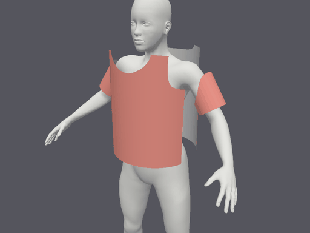

<p align="center">
  
</p>
<h2 align="center">The #1 Open-Source Clothes Modelling Software</h2>

<p align="center">
  
</p>

<br />

# Why Vitryne

Vitryne gives clothing enthusiasts, small and mature clothing brands the tool they need to easily create clothes before manufacturing. Vitryne is the software for creatives that saves you time and boost your creativity.

<br />

# Installation

### Cloud

The fastest way to get started. Sign up for Free at [vitryne.app](https://vitryne.app) and start creating in under a minute, with no infrastructure to manage and always up to date.

### Self-hosting

🏗️ Documentation Work in progress


# Features

- **Real-time GPU Cloth Simulation:** Extended Position Based Dynamics (XPBD) cloth solver with
  non-linear stretch, bending, sewing springs, SDF avatar collision, and self-collision untangling.
- **2D & 3D Garment Design:** Interactive 2D pattern inspection and flat arrangement alongside a 3D
  viewport with orbit camera, interactive cloth pinching/pulling, and placement handles.
- **Whole-Edge Sewing Engine:** Two-click seam creation with chain detection and automatic geometric
  seam suggestions that pair matching seams in seconds. Designed deliberately to avoid proprietary
  free-sewing patent restrictions ([docs/PATENTS.md](docs/PATENTS.md)).
- **Physical Fabric Presets:** Calibrated physical fabric parameters (weight, directional stretch and
  bending stiffness, thickness, friction) for Cotton jersey, Denim, Poplin shirting, Fleece, and Wool
  suiting ([docs/FABRICS.md](docs/FABRICS.md)), with multi-material simulation support.
- **Production 3D Export:** Export draped 3D garments to standard glTF 2.0 (`.glb`) or Wavefront
  OBJ (`.obj` + `.mtl`) with real-world 1:1 metre scale, vertex normals, double-sided PBR cloth
  materials, and UVs mapped directly to 2D pattern coordinates for texture printing.
- **Pattern Export (DXF-AAMA):** Export the pattern pieces back to cutting and CAD tools as
  DXF-AAMA (ASTM D6673), in millimetres, with corners, notches, grain lines, internal lines,
  quantities and cut-on-fold pieces as halves with a mirror line. Outlines are sewing lines (no
  seam allowance yet).
- **Saved as You Go:** Projects autosave to the cloud, like Figma or Canva. Try everything
  without an account (your work is kept as a draft); a free account keeps every project and
  exports. No telemetry.

<br />

# Requirements

Vitryne runs in any browser with **WebGPU**. The cloth simulation runs on your graphics card, so
the GPU matters most. The CPU only does real work once, when you import your own pattern.

| | Browser | GPU | CPU | RAM | OS |
|---|---|---|---|---|---|
| **Minimum** | Chrome or Edge 113+, Safari 18+, or Firefox with `dom.webgpu.enabled = true` in `about:config` | A GPU your browser can use through WebGPU: Apple silicon (M1 or later), or a dedicated card from about 2018 on | Any 64-bit CPU from the last ~6 years | 8 GB | macOS 14.4+, Windows 10/11, or Linux |
| **Recommended** | Up-to-date Chrome, Edge or Safari | Apple M2 or later, or a dedicated card with 4 GB of video memory or more | 4 cores or more | 16 GB | The latest macOS or Windows 11 |

Chrome and Edge save straight to a file you pick; Safari and Firefox save through a download. If
your browser or device has no WebGPU, Vitryne shows a page explaining what's missing.

<br />

## Known Limitations (Honestly)

Vitryne is under active development. Here is what does not work yet:

- **Whole-edge seams only:** Seams connect whole boundary edges between corners. Vitryne deliberately
  avoids free-hand partial seam drafting and notch-to-notch segment sewing in the UI to stay clear of
  competitor patent claims ([docs/PATENTS.md](docs/PATENTS.md)). Split lines must be in the pattern.
- **Single-layer garments:** The solver simulates one layer of cloth per panel. Complex multi-layer
  constructions (linings, fusible interfacings, quilted batting, or pockets sewn on top of bodies)
  are not yet supported.
- **Static rigid avatar collider:** The MakeHuman body is baked into a signed distance field (SDF).
  Dynamic skeletal rigging, avatar posing, and walking animations are planned for future versions.
- **Woven strain settling:** On high-tension woven garments (like the trousers example), resting edge
  strain reaches ~5.4% p99 under one XPBD iteration per substep, compared to the ideal 3% woven target.
- **Hoodie collar junction:** The hoodie test garment features extreme geometry at the back-neck
  junction and does not come to a static rest; it retains persistent self-intersections in tight folds.
- **No WebGL fallback:** The solver requires compute shaders and storage buffers available only in
  WebGPU.

---

## Development & CLI

### Prerequisites

- Rust 1.85+ with `wasm32-unknown-unknown` target: `rustup target add wasm32-unknown-unknown`
- `wasm-bindgen-cli` 0.2.129: `cargo install wasm-bindgen-cli --version 0.2.129`
- Node.js 22+ and pnpm 10: `corepack enable`
- A GPU with Vulkan, Metal, or DirectX 12 drivers.

### Commands

```sh
# Run the complete test suite (Rust fmt, clippy, unit tests, web check, golden drapes)
./check.sh

# Quick Rust-only check
./check.sh --quick

# Run the web editor locally (it starts a local Supabase in Docker to save projects to)
cd app && pnpm install --frozen-lockfile && pnpm run dev
# Open http://localhost:5173

# Run the native viewer
cargo run --release -p drape-native -- view --garment examples/tshirt.vtry

# Run headless native benchmarks
cargo run --release -p drape-native -- bench --scene garment --garment examples/tshirt.vtry --verts 10000
```

See [CONTRIBUTING.md](CONTRIBUTING.md) for contribution guidelines, code formatting, and sign-off rules.

### Hosting

Projects are saved to a Supabase project (hosted by Supabase, or your own). Set `SUPABASE_URL` and
`SUPABASE_PUBLISHABLE_KEY` in `deploy/.env`, then one command runs the editor:

```sh
docker compose -f deploy/docker-compose.yml up -d --build    # then open http://localhost:8000
```

Anyone can try it without an account (their work is kept as one draft); a free account (email and
password, or Google) keeps every project and exports, with data export and account deletion built
in. See [docs/CLOUD.md](docs/CLOUD.md) for setting up the backend, running it on a domain or
Coolify, and developing with a local Supabase (`pnpm run dev`). Any other static host works too,
with a `config.json` naming the backend ([docs/HOSTING.md](docs/HOSTING.md)).

---

## Licence & Intellectual Property

Vitryne's source code is licensed under the [GNU Affero General Public License v3.0 or later](LICENSE) (AGPL-3.0-or-later).

### **What you make with Vitryne is yours**

**Garments, patterns, 3D meshes, textures, `.vtry` project files, and any other files you create or export with Vitryne are strictly yours.** They are user data and output, not covered by the AGPL, and you retain complete ownership to use, modify, distribute, or sell them commercially or non-commercially without restriction.

Bundled sample assets preserve their respective open licences:
- **MakeHuman Avatar Mesh:** [Creative Commons Zero (CC0 1.0)](assets/LICENSES.md).
- **FreeSewing Patterns (Teagan T-shirt, Titan Trousers, Hugo Hoodie):** [MIT License](assets/LICENSES.md).
