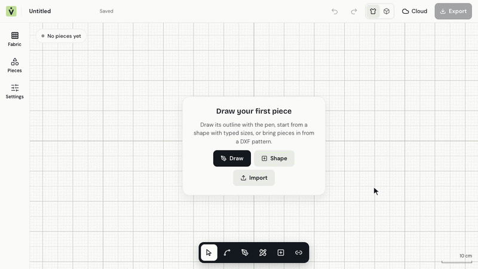
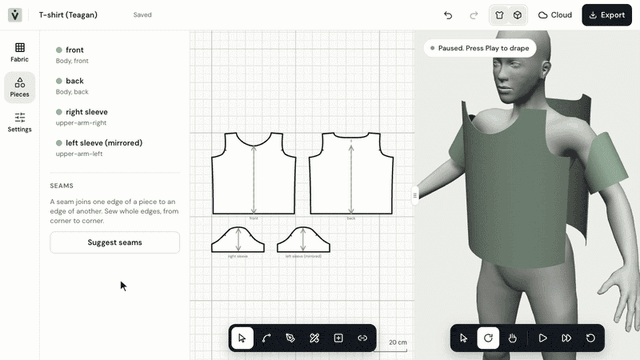
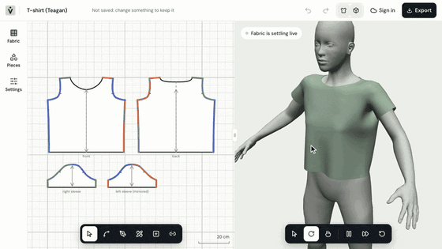
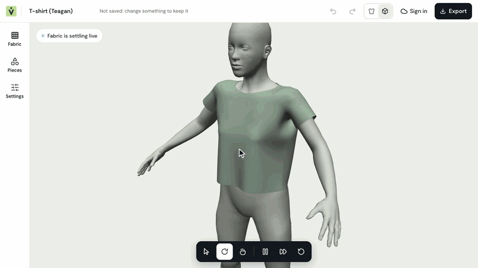

<p align="center">
  
</p>
<h2 align="center">The first Open-Source Clothes Modelling Software</h2>

<br />

# Why Vitryne

Vitryne gives indie creators, small and established clothing brands the tool they need to easily create clothes before manufacturing. Vitryne is the software for creatives that saves you time and boost your creativity.

<br />

# Features

<table align="center">
  <tr>
    <td width="50%">
      <picture>
        
      </picture>
      <p align="center">Draw precise patterns</p>
    </td>
    <td width="50%">
      <picture>
        
      </picture>
      <p align="center">Easily sew pieces together</p>
    </td>
    
  </tr>
  <tr>
    <td width="50%">
      <picture>
        
      </picture>
      <p align="center">Pinch & Place</p>
    </td>
    <td width="50%">
      <picture>
        
      </picture>
      <p align="center">Customise Fabrics to your taste</p>
    </td>
  </tr>
</table>

<br />

# Installation

###  Cloud

The fastest way to get started. Sign up for Free at [vitryne.app](https://vitryne.app) and start creating in under a minute, with no infrastructure to manage and always up to date.

###  Self-hosting

From a [release](https://github.com/H4kken/vitryne/releases), with its own backend (editor,
database, accounts and storage in five small containers, nothing else to set up; needs Docker
Compose 2.23.1 or later):

```sh
curl -fsSLO https://github.com/H4kken/vitryne/releases/latest/download/docker-compose.selfhost.yml
curl -fsSLO https://github.com/H4kken/vitryne/releases/latest/download/setup.sh
sh setup.sh        # writes .env with fresh keys; `sh setup.sh your.domain` for a server with HTTPS
docker compose up -d
# then open http://localhost:8000
```

Or one container with a [Supabase](https://supabase.com) project of your own for the backend:
[Cloud backend](packages/vitryne-docs/content/docs/developers/cloud.md).

<br />

# Requirements

Vitryne runs in any browser with **WebGPU**. The cloth simulation runs on your graphics card, so
the GPU matters most. The CPU only does real work once, when you import your own pattern.

| | Browser | GPU | CPU | RAM | OS |
|---|---|---|---|---|---|
| **Minimum** | Chrome or Edge 113+, Safari 18+, or Firefox with `dom.webgpu.enabled = true` in `about:config` | A GPU your browser can use through WebGPU: Apple silicon (M1 or later), or a dedicated card from about 2018 on | Any 64-bit CPU from the last ~6 years | 8 GB | Any |
| **Recommended** | Up-to-date Chrome, Edge or Safari | Apple M2 or later, or a dedicated card with 4 GB of video memory or more | 4 cores or more | 16 GB | Any |

Chrome and Edge save straight to a file you pick; Safari and Firefox save through a download. If
your browser or device has no WebGPU, Vitryne shows a page explaining what's missing.

<br />

# Development & Contributing

###  Tech Stack

- 🦀 <a href="https://rust-lang.org/">Rust</a>
-  <a href="https://www.typescriptlang.org/">TypeScript</a> with  <a href="https://vite.dev/">Vite</a> &  <a href="https://react.dev/">React</a>
-  <a href="https://supabase.com/">Supabase</a>

###  Contributing

See [CONTRIBUTING.md](CONTRIBUTING.md) for contribution guidelines, code formatting, and sign-off rules.

###  Prerequisites

- Rust 1.85+ with `wasm32-unknown-unknown` target: `rustup target add wasm32-unknown-unknown`
- `wasm-bindgen-cli` 0.2.129: `cargo install wasm-bindgen-cli --version 0.2.129`
- Node.js 22+ and pnpm 10: `corepack enable`
- A GPU with Vulkan, Metal, or DirectX 12 drivers.

<br />

# Licence & Intellectual Property

Vitryne's source code is licensed under the [GNU Affero General Public License v3.0 or later](LICENSE) (AGPL-3.0-or-later).

### **What you make with Vitryne is yours**

**Garments, patterns, 3D meshes, textures, project files, and any other files you create or export with Vitryne are strictly yours.** They are user data and output, not covered by the AGPL, and you retain complete ownership to use, modify, distribute, or sell them commercially or non-commercially without restriction.

Bundled sample assets preserve their respective open licences:
- **MakeHuman Avatar Mesh:** [Creative Commons Zero (CC0 1.0)](assets/LICENSES.md).
- **FreeSewing Patterns (Teagan T-shirt, Titan Trousers, Hugo Hoodie):** [MIT License](assets/LICENSES.md).
