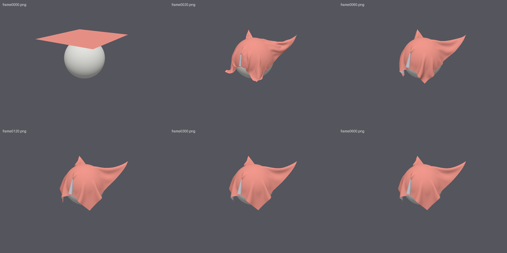
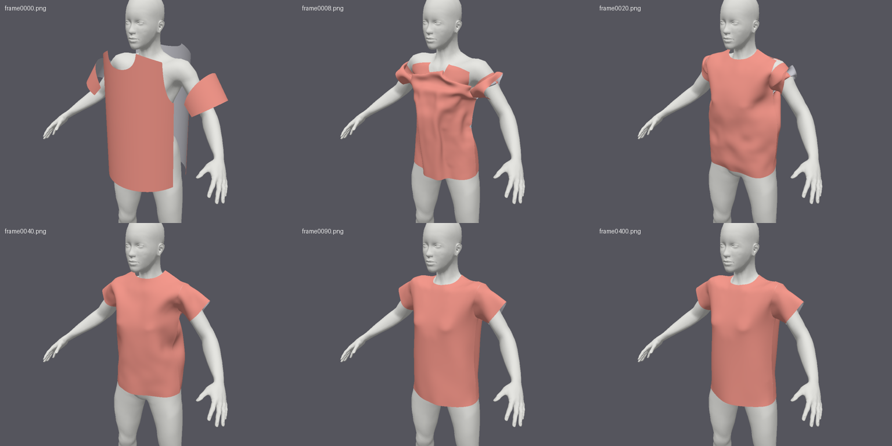
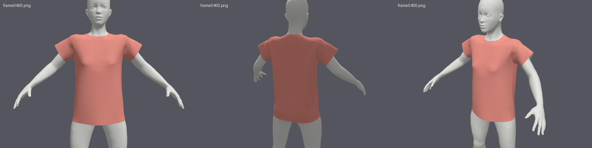
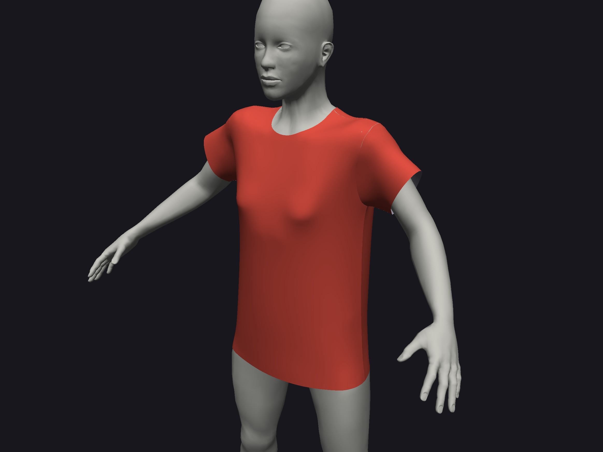
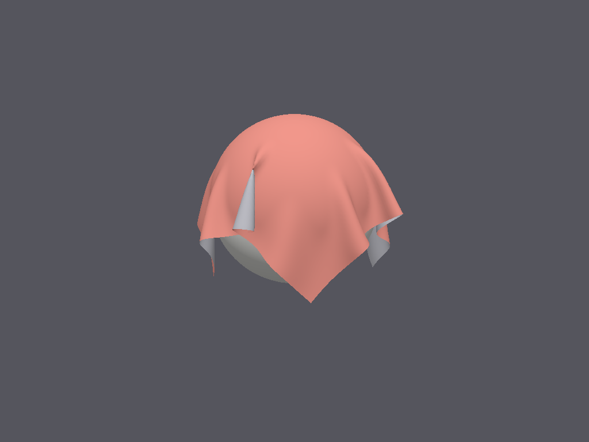
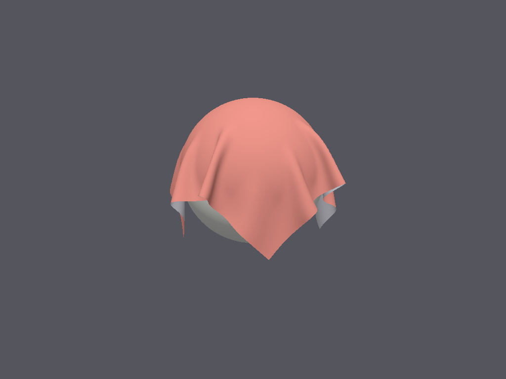
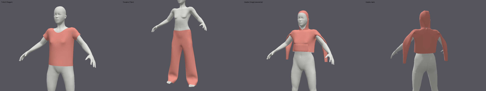

# Progress

> **Archive.** This is the `drape-spike` progress log as it stood at the end of the spikes (2026-10-12), kept for its history and numbers. Paths in it are the spike's: the spike's bench scripts were replaced by the general ones in `tools/bench/` (`run.sh`, `summary.py`, `compare.py`), and the raw benchmark output (`bench/…`) was left out of this repository's history to keep it small. Current progress is in [../../PROGRESS.md](../PROGRESS.md).

Machine used so far: MacBook Air, Apple M2 (integrated GPU), macOS (Darwin 27). Rust 1.99.0, wgpu 30.0.1, wasm-bindgen 0.2.129, Vite 8.3.1, Chrome 150.

## How to run

```sh
# native
cargo run -p drape-native --release -- info              # adapter report JSON
cargo run -p drape-native --release -- snapshot out.ppm  # headless render check
cargo run -p drape-native --release                       # viewer: M1 sheet (drag orbit, wheel zoom, space pause, R reset)
cargo run -p drape-native --release -- bench --grid 100 --out bench/m1/grid100.json   # headless bench, JSON
cargo run -p drape-native --release -- frames --at 0,60,600 --out-dir /tmp/f          # render sim frames to PNG
# T-shirt on the avatar (M2): add --scene tshirt [--edge 0.00864] [--sdf-cell 0.004] to view/bench/frames
cargo run -p drape-native --release -- bench --scene tshirt --edge 0.00864 --out bench/m2/tshirt_10k.json
cargo run -p drape-native --release -- pattern-svg pattern.svg     # meshed pattern + seams
# scene/sim flags: --grid N --substeps S --damping D --friction MU --pin-spacing F --no-sphere
# add --gpu-timestamps to any native command for the opt-in profiling mode

# web (needs: rustup target add wasm32-unknown-unknown; cargo install wasm-bindgen-cli --version 0.2.129)
cd web && npm install && npm run dev                      # builds wasm, serves http://localhost:5173
node web/tools/chrome-check.mjs http://localhost:5173/ shot.png   # headless real-Chrome check (GPU on)
# web profiling mode: append ?gpu-timestamps=1 to the URL

# browser viewer (M3): http://localhost:5173/ (T-shirt 5k-40k or sheet; drag cloth, F = fast drape)
#   automation: /?auto=1&scene=tshirt:0.00864[&post=1&dir=m3&name=X]
# drag stability (M3): cargo run -p drape-native --release -- bench-drag --scene tshirt --seed 1
# browser bench (same code as `drape bench`): open http://localhost:5173/bench.html, press Run, Copy JSON
#   automation: bench.html?auto=1&grids=10,100&substeps=20&frames=1200[&ts=1][&post=1&name=X]
#   post=1 makes the page send its JSON to the dev server -> bench/browser-check/X.json
node web/tools/chrome-check.mjs "http://localhost:5173/bench.html?auto=1&grids=100" shot.png 590000 out.json
python3 bench/compare.py bench/browser-check/chrome-grids.json     # native vs browser table
# self-collision (M4): add --self-collision [--self-rebuild K] to view/bench/bench-drag; --no-pins drops the sheet
cargo run -p drape-native --release -- bench --scene sheet --no-pins --self-collision --out bench/m4/native/drop-sc-k1.json
#   web: viewer checkbox "self-collision" (C), scene "Sheet 10k dropped"; bench.html checkbox, or &sc=1&rebuild=K&nopins=1
python3 bench/m4/compare_m4.py bench/m4/browser/chrome_tshirt_sc_k1.json   # native vs browser, M4
# spike 2, S2: DXF-AAMA garments (assets/garments/<g>/garment.toml; g = tshirt | trousers | hoodie)
cargo run -p drape-native --release -- bench --scene garment --garment assets/garments/tshirt/garment.toml --verts 10000 --self-collision --self-rebuild 4
cargo run -p drape-native --release -- garment-svg out.svg --garment assets/garments/hoodie/garment.toml   # landmark numbers, seams
python3 bench/s2/summary.py bench/s2/native/*.json --seams
cd tools/patterns && npm install && ./export-all.sh       # regenerate the DXFs from FreeSewing
# spike 2, S3: drag test on the garments (contact velocity filter on by default; --contact-max-accel 0 = S2 behaviour)
bench/s3/one.sh tshirt 10000 1 out.json                       # one run, one summary line (stable = S3 criterion)
bench/s3/run.sh bench/s3/final/native                          # 3 garments x {10k, 20k} x seeds 1-6
PORT=5173 bench/s3/chrome.sh bench/s3/final/chrome "tshirt trousers hoodie" 10000 "1 2 3 4 5 6"   # same in headless Chrome
python3 bench/s3/final_table.py                                # the S3 table
#   web: bench.html garment select (or &garment=tshirt|trousers|hoodie, res = vertex count), &cap=A
DRAPE_DEBUG_ATTRIB=1 bench/s3/one.sh tshirt 10000 1 out.json   # per-phase attribution of every spike frame -> out.log
# spike 2, S4: untangling, on by default with --self-collision (--untangle-every 0 = S3 bit for bit)
bench/s3/one.sh tshirt 10000 6 out.json [--untangle-every N --untangle-check-every M --untangle-step F]
#   web: bench.html "untangle every" field, or &ut=N (bench.html and viewer)
```

## Measurement modes

- **Canonical (default):** `Features::empty()` + `Limits::default()`. Every pass/fail number comes from this mode.
- **Profiling (`--gpu-timestamps` native, `?gpu-timestamps=1` web):** additionally requests WebGPU `timestamp-query` and nothing else, and uses only pass-level `timestampWrites` (core WebGPU; the native-only `TIMESTAMP_QUERY_INSIDE_*` features stay off). Used only to find which pass dominates GPU time (M5). Every report has `"gpu_timestamps": true|false`; device creation asserts that no other feature is ever requested. If the adapter lacks timestamps, it logs a warning and falls back to canonical.

---

## M0 — Setup ✅ (2026-10-11)

**Done-when met:** a coloured triangle renders natively (Metal) and in Chrome via the WebGPU backend. Screenshots are in [docs/m0/](m0/).

### What works
- Cargo workspace: `drape-core`, `drape-assets` (empty stub), `drape-native`, `drape-web`. The repo root is the `drape-spike/` from the plan.
- `drape_core::gpu::Gpu::new` is the **only** device-creation path, used by both targets:
  - requests `Features::empty()` + `Limits::default()` (checked: wgpu 30's `Limits::defaults()` equals the WebGPU spec defaults)
  - **asserts** after creation that `device.features() == empty` and `device.limits() == Limits::default()`
  - logs the adapter's real features/limits next to the device's, as JSON
- Backends: native allows Metal, Vulkan and DX12 only (no GL). Wasm builds wgpu with `default-features = false, features = ["webgpu", "wgsl", "std"]` and requests `Backends::BROWSER_WEBGPU` only. The wasm binary has no WebGL code (0 `webgl` strings), and the web entry errors out if the backend isn't `BrowserWebGpu`.
- One WGSL file (`crates/drape-core/shaders/triangle.wgsl`), loaded with `include_str!`, is used by both targets.
- Web: `wasm-bindgen-cli` + plain Vite page (`web/`); no framework.

### Numbers
| | Native (Metal, Apple M2) | Chrome 150 (WebGPU, Metal underneath) |
|---|---|---|
| Backend reported | `Metal` | `BrowserWebGpu` |
| Device features | none | none |
| Device `maxStorageBufferBindingSize` | 128 MiB | 128 MiB |
| Device `maxStorageBuffersPerShaderStage` | 8 | 8 |
| Device `maxComputeInvocationsPerWorkgroup` | 256 | 256 |
| Device `maxComputeWorkgroupStorageSize` | 16 KiB | 16 KiB |
| Adapter `maxStorageBufferBindingSize` (not used) | 4 GiB | 4 GiB |
| Adapter `maxStorageBuffersPerShaderStage` (not used) | 29 | 10 |
| Adapter offers `TIMESTAMP_QUERY` | yes | yes |
| wasm size (release, after wasm-bindgen) | — | 277 KB (70 KB gzip) |

### Open problems / notes
- **Timestamp queries vs. hard rule 1: resolved (you approved, 2026-10-11).** There is an opt-in profiling mode (see "Measurement modes"). Canonical numbers use CPU timing around `queue.submit` + `on_submitted_work_done`. `drape_core::timer::GpuTimer` gives per-pass GPU times on both targets and does nothing in canonical mode.
  - Triangle pass, 512² (web) / 256² (native): **native Metal 0.049 ms, Chrome 0.046 ms.** Chrome values have µs-level resolution even without `--enable-webgpu-developer-features` (0.044 ms with it). Safari and Firefox timestamp support/resolution are still to be checked in M3.
- Chrome doesn't reveal the adapter name or vendor to the page (empty strings, device_type `Other`). Machine identity for the report has to be recorded by hand.
- gstack's headless Chromium has no GPU adapter (`requestAdapter` returns null), so it can't run WebGPU tests. Browser checks go through `web/tools/chrome-check.mjs`, which drives the installed Google Chrome over CDP with the GPU on.
- Native viewer: launched and ran without errors. I couldn't screenshot the window from the CLI (no accessibility permission), so pixels were checked with the offscreen `snapshot` command, which uses the same renderer.
- Safari and Firefox are not tested yet (that's M3).
- Not tested yet on the Windows laptop.

## M1 — GPU cloth sheet ✅ (2026-10-11)

**Done-when met:** the sheet drapes stably on native, `drape bench` prints JSON, and the numbers are below. Raw JSON is in `bench/m1/`; frames are in [docs/m1/sheet-10k.png](m1/sheet-10k.png).



### What works
- **Scene:** a 1 m square sheet, 1 m up, pinned at the two corners of one edge, falls onto a 30 cm sphere. The pins are 0.9 m apart (`pin_spacing`; see the taut-pins problem below).
- **Solver:** XPBD with small steps, 20 substeps per frame and 1 iteration per substep, entirely on the GPU in [sim.wgsl](../../packages/vitryne-engine/solver/shaders/sim.wgsl). Each substep runs: predict → stretch (one dispatch per colour) → bend (one dispatch per colour) → sphere collision with friction → velocity update. There is no CPU readback in the step.
  - **Stretch:** one distance constraint per mesh edge.
  - **Bending:** isometric bending (Bergou 2006). The curvature `C = Σ kᵢxᵢ`, with cotangent weights computed from the rest shape, is linear in positions. So the XPBD update is closed-form and doesn't blow up when the cloth is flat, unlike dihedral-angle bending. The weights come from the *rest* mesh, ready for M2's flat 2D pattern pieces.
  - **No float atomics:** constraints are greedy graph-coloured on the CPU. The grid needs 8 colours for stretch and 18 for bending, at every size. Unit tests check that no vertex appears twice in one colour, and that bending is zero when flat and nonzero when folded.
  - **Colour ranges:** each colour's range is picked with a **dynamic uniform offset**, so no push constants are needed (rule 1).
- **Material:** placeholder cotton (`Material::cotton()`): 0.15 kg/m², stretch stiffness 1e4 N/m, bending stiffness 5e-6 N·m. Damping is 1.0/s, collision thickness 2 mm, friction 0.3.
- **Metrics:** a GPU reduction ([metrics.wgsl](../../packages/vitryne-engine/solver/shaders/metrics.wgsl)) turns the mesh into 16 bytes: kinetic energy, max speed, min distance to the sphere, and a count of NaN/inf values (detected with a bit test, which compiler optimisations can't remove). The bench reads those 16 bytes once per frame, outside the timed region.
- **Rest rule:** the free vertices' RMS speed stays below 5 mm/s for 30 frames in a row. The rest frame is the first frame of that streak.
- **`drape bench`:** two timings. Serial = submit → GPU done, one frame at a time, which is pessimistic. Pipelined = 300 frames queued back to back, which is what an interactive loop gets. It also records the rest frame, max speeds, NaN frames, buffer sizes, a speed trace, the 10 fastest vertices at the end (to find jitter spots), and per-phase GPU ms in profiling mode. The bench code is async and also builds for wasm, ready for M3.
- **Viewer:** normals recomputed on the GPU by gathering each vertex's triangles (no atomics), two-sided lighting, orbit camera. It holds a steady **60 fps (vsync) at 10k vertices**.
- **Limits used:** at most 5 storage buffers per stage (limit 8) and workgroup size 64 everywhere. The largest storage binding at 40k vertices is 5.7 MB, against the 128 MiB limit. All simulation buffers at 40k total 9.5 MB.

### Numbers (native Metal, Apple M2, canonical mode, 20 substeps, 1200 frames)

| Vertices | Colours (stretch+bend) | Dispatches per frame | **Pipelined ms per frame** | Serial ms per frame, median / p95 | Rest frame (sim s) | **Wall time to rest, pipelined** | Max speed after 1 s | NaN frames |
|---|---|---|---|---|---|---|---|---|
| 100 | 8+18 | 580 | 0.84 | 1.28 / 1.79 | 452 (7.5 s) | 0.38 s | 1.24 m/s | 0 |
| 2,500 | 8+18 | 580 | 0.99 | 1.43 / 1.71 | 287 (4.8 s) | 0.28 s | 0.56 m/s | 0 |
| 5,041 | 8+19 | 600 | 1.12 | 1.54 / 1.76 | 440 (7.3 s) | 0.49 s | 0.74 m/s | 0 |
| **10,000** | 8+18 | 580 | **1.33** | 1.79 / 1.99 | 462 (7.7 s) | **0.61 s** | 1.43 m/s | 0 |
| 19,881 | 8+18 | 580 | 2.18 | 2.65 / 2.82 | 458 (7.6 s) | 1.00 s | 1.34 m/s | 0 |
| 40,000 | 8+18 | 580 | 4.15 | 4.75 / 4.90 | 582 (9.7 s) | 2.41 s | 2.08 m/s | 0 |

Min distance to the sphere at rest is 2.00 mm at every size, which equals the collision thickness: no penetration.

**10k vertices, varying substeps:**

| Substeps | Pipelined ms | Rest frame | Wall time to rest |
|---|---|---|---|
| 10 | 0.69 | 336 | 0.23 s |
| 15 | 1.00 | 401 | 0.40 s |
| 20 | 1.33 | 462 | 0.61 s |
| 30 | 1.98 | 731 | 1.45 s |

Fewer substeps rest sooner because they add numerical damping. More substeps make the cloth effectively stiffer and less damped.

**GPU time by phase (profiling mode, ms per frame, summed over 20 substeps):**

| Vertices | predict | stretch | **bend** | collide | update |
|---|---|---|---|---|---|
| 10k | 0.12 | 0.46 | **1.05** | 0.09 | 0.11 |
| 40k | 0.34 | 1.41 | **3.13** | 0.22 | 0.29 |

Bending is about 55% of GPU time and stretch about 25%. Profiling uses one pass per phase per substep, so these numbers include extra per-pass overhead and add up to more than the canonical frame time. Only the shares are meaningful.

### Findings
- **Dispatch overhead is the main cost at garment sizes.** The 100-vertex grid runs the same 580 dispatches as the 10k grid, with almost no work, and still costs 0.84 ms per frame. That's about **1.45 µs per dispatch** on native Metal, so roughly 60% of the 10k frame is fixed overhead, and 10k → 40k scales sub-linearly. This is the plan's "graph colouring → too many dispatches" risk, now measured. Browser dispatch overhead is likely higher, so M3 should check this first. Ways to cut it, if needed: fewer colours (each colour is a dispatch), fewer substeps with more iterations, or merging stretch and bend into one coloured pass.
- **Sim time vs wall time.** Reaching rest takes 5–10 s of *simulated* time at the current damping, but the sim runs 12× faster than real time at 10k, so wall time is 0.6 s. A viewer locked to vsync, running one sim frame per display frame, would show it as 7.7 s. **For the "< 3 s to rest" test, the drape has to run unlocked (several sim frames per display frame).** I'll do that in M2/M3.
- **The whip spike is physical.** The max speed of 9–16 m/s around frame 20 is the free edge whipping at the bottom of the first swing (the far edge falls about 1.4 m). It also happens without the sphere and at 40 substeps, and it decays. After 1 s, the max is ≤ 2.1 m/s at every size. The bench reports both: `max_speed_over_5ms` is the raw plan criterion and is true here; `exploded` means NaN or ≥ 5 m/s after 1 s, and is false at every size. The 5 m/s criterion was written for the T-shirt and drag tests, where nothing free-falls 1 m.

### Open problems / notes
- **Taut pins vibrate.** With the pins exactly at rest length (`--pin-spacing 1.0`), the nearly inextensible edge between them can't sag, so it vibrates like a taut string (46 mm/s at the edge midpoint, found through `final_fastest_vertices`). It still rests at frame 663 with damping 1.0, but at damping 0.5 it never did. Garments have no pins, so this matters less, but the stiff-constraint jitter mechanism may come back at seams.
- **Damping:** the default went from 0.5/s to 1.0/s. At 0.5/s the slack case rests at frame 723 instead of 462. Simple velocity damping is crude: it also slows the fall (terminal speed ≈ 9.8 m/s). A better damping model is in "Later".
- **No self-collision yet (done in M4).** Folds can pass through each other; the back face shows through on the left flap in the frames.
- The grid-of-100 run shows a 10.7 m/s spike at frame 0. That comes from the 10% initial compression being released on a very coarse mesh (11 cm edges), and it's irrelevant to the other sizes.
- Material values are placeholders, not calibrated (out of scope).
- Not tested on Windows yet. The web build still renders the M0 triangle; the cloth goes to the browser in M3.

## Browser check (pulled forward from M3) ✅ (2026-10-11)

**Question:** does the browser add enough cost per GPU job to break the "< 3 s to rest" test?
**Answer: no.** On this M2, Chrome is **1.10–1.19×** native and Safari **1.00–1.14×**. Both are well inside the plan's "browser ≤ 2× native". Raw JSON is in `bench/browser-check/`.

### How it was measured
- [bench.html](../../web/bench.html) calls `drape_web::run_bench`, which runs the **same `drape_core::bench::run`** as the native CLI, with the same scene, defaults and frame counts (1200 frames).
- Each run gets a fresh device, with no features and default limits. Both browsers report the `BrowserWebGpu` backend and empty features.
- The page is served cross-origin isolated (COOP/COEP in [vite.config.js](../../web/vite.config.js)), so `performance.now()` has fine resolution in both browsers.
- **Chrome 150:** headless with the real GPU, driven by `chrome-check.mjs` over CDP.
- **Safari 27.0.1:** opened normally (`open -a Safari …?auto=1&post=1`). The page POSTs its JSON to a dev-only endpoint on the Vite server, because Safari remote automation needs a sudo setting.

### Native vs Chrome (20 substeps)

| Vertices | Native ms per frame | Chrome ms per frame | Ratio | Rest frame (native / Chrome) | Wall time to rest (native / Chrome) | Chrome NaN frames |
|---|---|---|---|---|---|---|
| 100 | 0.84 | 0.98 | 1.16× | 452 / 451 | 0.38 / 0.44 s | 0 |
| 2,500 | 0.99 | 1.16 | 1.17× | 287 / 278 | 0.28 / 0.32 s | 0 |
| 5,041 | 1.12 | 1.31 | 1.17× | 440 / 466 | 0.49 / 0.61 s | 0 |
| **10,000** | 1.33 | **1.56** | 1.17× | 462 / 460 | 0.61 / **0.72 s** | 0 |
| 19,881 | 2.18 | 2.39 | 1.10× | 458 / 488 | 1.00 / 1.17 s | 0 |
| 40,000 | 4.15 | 4.94 | 1.19× | 582 / 541 | 2.41 / 2.67 s | 0 |

**10k vertices in Chrome, varying substeps:** 10 → 0.79 ms (1.15×), 15 → 1.15 ms (1.15×), 30 → 2.26 ms (1.14×).

### Native vs Safari (20 substeps)

| Vertices | Native ms per frame | Safari ms per frame | Ratio | Rest frame (native / Safari) | Wall time to rest (native / Safari) | Safari NaN frames |
|---|---|---|---|---|---|---|
| 100 | 0.84 | 0.89 | 1.06× | 452 / 451 | 0.38 / 0.40 s | 0 |
| 2,500 | 0.99 | 1.13 | 1.14× | 287 / 267 | 0.28 / 0.30 s | 0 |
| 5,041 | 1.12 | 1.17 | 1.05× | 440 / 440 | 0.49 / 0.52 s | 0 |
| **10,000** | 1.33 | **1.45** | 1.09× | 462 / 458 | 0.61 / **0.66 s** | 0 |
| 19,881 | 2.18 | 2.18 | 1.00× | 458 / 444 | 1.00 / 0.97 s | 0 |
| 40,000 | 4.15 | 4.63 | 1.12× | 582 / 569 | 2.41 / 2.64 s | 0 |

### Cost per GPU job (the M1 worry)
The 100-vertex sheet is almost pure overhead: 580 dispatches with almost no work in each.

| | Native Metal | Chrome | Safari |
|---|---|---|---|
| Per dispatch | 1.45 µs | 1.7 µs | 1.5 µs |

The browsers add 3–17% per dispatch, not multiples. The 26 colours × 20 substeps design holds in the browser.

### GPU time by phase (profiling mode, ms per frame)

| | predict | stretch | bend | collide | update |
|---|---|---|---|---|---|
| Native 10k | 0.12 | 0.46 | 1.05 | 0.09 | 0.11 |
| Chrome 10k | 0.18 | 0.99 | 2.60 | 0.15 | 0.16 |
| Safari 10k | 0.14 | 0.71 | 1.43 | 0.10 | 0.11 |
| Native 40k | 0.34 | 1.41 | 3.13 | 0.22 | 0.29 |
| Chrome 40k | 0.17 | 1.16 | 3.60 | 0.11 | 0.17 |
| Safari 40k | 0.16 | 1.19 | 2.88 | 0.12 | 0.16 |

Bending is the biggest phase on every target. Both browsers support `timestamp-query`. Profiling mode uses one pass per phase per substep, so absolute numbers carry per-pass overhead. Chrome's 10k row is inflated by that overhead, which is more than its canonical 1.56 ms frame.

### Notes / open problems
- **Results agree but aren't bit-identical across targets.** Rest frames differ by 0–10% (40k: native 582, Chrome 541, Safari 569). The shader compilers differ (naga→MSL on native, Tint/Dawn in Chrome, WebKit's compiler in Safari), and a falling cloth amplifies tiny floating-point differences. Stability and penetration agree everywhere: no NaNs, min distance 2.00 mm, max speed after 1 s ≤ 2.1 m/s. M3's "same results within tolerance" needs a real definition, for example the final shape compared within N mm instead of identical rest frames.
- **Still untested:** Firefox (not installed here) and the Windows laptop. Running there just means opening `bench.html` and pressing Run, then Copy JSON.
- Safari ran in a visible, focused window. Background tabs may be throttled, so for manual runs keep the tab in front.
- `chrome-check.mjs` used to cut piped output at 64 KB (`process.exit` drops buffered stdout). It now writes the report to a file and sets `exitCode` instead.

## M2 — T-shirt on the body, native ✅ (2026-10-11)

**Done-when met:** the T-shirt drapes onto the avatar and comes to rest without explosions at 10k and 20k vertices, and also at 5k and 40k. Raw JSON is in `bench/m2/`.




### What works
- **Avatar:** the MakeHuman base mesh (CC0), body group only, in metres. 13,380 vertices and 26,756 triangles, A-pose, 1.67 m tall. The source, license and measurements are in [assets/body/README.md](../../assets/body/README.md).
- **Body on the CPU** ([body.rs](../../packages/vitryne-engine/solver/src/body.rs)):
  - a triangle BVH (built in 18 ms)
  - exact signed distance, with the sign from angle-weighted pseudo-normals (unit-tested on a cube for face, edge and vertex regions)
  - a narrow-band **SDF bake**: exact within ±4 cm, and only the sign beyond that, from one BVH ray per grid row
- **SDF size:** a box around the torso and upper arms at 4 mm is 226×216×126 = **24.6 MB, baked in 0.43 s** on native (multi-threaded with rayon). It's cached under `target/sdf-cache/`, and the bake also builds for wasm.
- **SDF on the GPU:** stored in a storage buffer and sampled by hand with trilinear interpolation and an analytic gradient in [sdf.wgsl](../../packages/vitryne-engine/solver/shaders/sdf.wgsl). Core WebGPU can't filter float 3D textures, so the shader does it. The same snippet is prepended to the sim and metrics shaders.
- **Collision:** each vertex is projected out to `sdf ≥ 2 mm` along the gradient, with the same Coulomb friction as M1.
- **Procedural T-shirt** ([tshirt.rs](../../packages/vitryne-engine/pattern/src/tshirt.rs)): front, back and 2 sleeves as 2D polygons in metres, with 10 seams. The pieces are sized from the avatar's measurements: chest 0.96 m around with ease, sleeve opening 0.34 m. The meshed pattern with colour-coded seams is in [docs/m2/pattern-10k.png](m2/pattern-10k.png).
- **Meshing** ([meshing.rs](../../packages/vitryne-engine/pattern/src/meshing.rs)): the boundary is resampled at the target edge length, and both sides of each seam get **the same segment count**. The interior is an equilateral lattice, and spade's constrained Delaunay triangulation joins the two. The mean edge comes out within 1% of the target.
- **Sewing:** zero-length constraints, graph-coloured (3 colours), stored after the stretch constraints in the same buffer so no extra binding is needed.
  - **Ramp-in:** compliance goes from 1e-2 to 1e-8 over 0.5 s, on a log scale.
  - **Correction clamp:** at most 0.5 mm per vertex per substep while the seams close. Seams close within about 20 frames from initial gaps of up to 372 mm (mean 158 mm).
- **Initial placement:** hardcoded for this garment. The body panels sit on a cylinder of radius 0.20 m around the torso, front in front and back behind. The sleeves are wrapped on a cylinder of radius 0.10 m around each measured upper-arm axis. **No vertex starts inside the body.**
- **Schedule:** gravity is off for 0.6 s, so the panels don't fall before the seams have closed, and then ramps to full over 0.3 s. Ramped parameters are a 96-byte uniform upload per frame, not a readback. Rest detection can't start until all ramps have finished.
- **Bench additions:**
  - an **exact CPU penetration check** at the end of the run: BVH signed distance for every cloth vertex
  - the SDF-vs-exact error at those vertices
  - per-seam gaps, including where along each seam the worst gap is
  - each of the fastest vertices labelled with its panel
- **Viewer:** `--scene tshirt` runs at 60 fps at 10k vertices. **F** toggles *fast drape*, 8 sim frames per display frame, so the drape should settle in about 0.7 s on screen instead of 5.6 s. That's calculated (333 frames ÷ 8 ÷ 60 fps); the key press itself hasn't been exercised, because the smoke test is headless.

### Numbers (native Metal, Apple M2, normal mode, 20 substeps, 4 mm SDF, 900 frames)

| Target | Vertices | Mean edge (mm) | Colours (stretch+sew+bend) / dispatches | **Pipelined ms per frame** | Serial median ms | Rest frame (sim time) | **Wall time to rest** | Max speed (m/s) | Max speed after ramps | **Exact max penetration (mm)** | GPU min SDF distance (mm) | SDF error (mm) | Max seam gap (mm) | NaN frames |
|---|---|---|---|---|---|---|---|---|---|---|---|---|---|---|
| 5k | 5,053 | 12.4 | 8+3+18 / 640 | 1.28 | 1.78 | 274 (4.6 s) | **0.35 s** | 3.85 | 1.05 | **0.00** | 1.90 | 0.95 | 1.5 | 0 |
| **10k** | 10,002 | 8.7 | 8+3+18 / 640 | **1.85** | 2.30 | 333 (5.6 s) | **0.62 s** | 4.41 | 1.47 | **0.00** | 1.83 | 1.19 | 1.5 | 0 |
| **20k** | 19,967 | 6.2 | 9+3+18 / 660 | **3.19** | 3.42 | 347 (5.8 s) | **1.11 s** | 4.86 | 1.96 | **0.00** | 1.92 | 1.36 | 2.2 | 0 |
| 40k | 39,674 | 4.4 | 9+3+18 / 660 | 5.16 | 5.70 | 328 (5.5 s) | **1.69 s** | 3.92 | 3.92 | **0.00** | 1.91 | 1.39 | 3.5 | 0 |
| 10k, 3 mm SDF | 10,002 | 8.7 | 8+3+18 / 640 | 1.94 | 2.53 | 337 (5.6 s) | 0.65 s | 4.34 | 1.41 | 0.00 | 1.95 | 0.95 | 1.5 | 0 |

Against the plan's criteria, on native so far:
- **Drape to rest < 3 s:** ✅ at every size, measured as wall time with frames queued back to back.
- **Body penetration at rest < 2 mm:** ✅ 0.00 mm, exact, at every size.
- **Stability:** ✅ no NaNs, and the max speed stays under 5 m/s **including the sewing phase**. That's the raw criterion with nothing excluded; unlike the M1 sheet, nothing free-falls here.

**GPU time by phase at 10k (profiling mode, ms per frame):**

| predict | stretch | sew | bend | collide (SDF) | update |
|---|---|---|---|---|---|
| 0.12 | 0.48 | 0.14 | **1.08** | 0.37 | 0.12 |

Bending is still the biggest phase. SDF collision, which does 8 scattered reads per vertex, costs 3× the analytic sphere.

### Findings
- **The most important bug: the sewing clamp must be lifted once the seams are closed.** At first the 0.5 mm clamp stayed on for the whole run. Under gravity, the closed seams then crept open, the sleeves slid down the A-pose arms, and the whole shirt fell off within 2 s (final seam gap 1.7 m). The clamp now applies only during the 0.5 s ramp. Closed seams need larger corrections under load than the clamp allows.
- **Seam gaps at rest are small, but the four-way underarm junction is sensitive to the mesh.** Mean gaps are 0.05–0.4 mm. The maximum is 1.5–3.5 mm in the main runs, always at the underarm junction, where the front, back and both sleeve corners meet in the armpit crease and the torso and arm surfaces both push outward. In one earlier mesh (edge 8.8 mm, 9,637 vertices, tshirt_9.6k_edge8.8mm.json (`bench/m2/tshirt_9.6k_edge8.8mm.json`)), that junction stayed open by **18 mm**, while everything else was below 4 mm. A taller sleeve cap made it worse (24 mm), so I reverted it. Merging junction vertices once they meet would remove this. That's in "Later".
- **A 4 mm SDF is good enough.** Against the exact distance, its error at the cloth vertices is ≤ 1.4 mm. A 3 mm SDF lowers that to 0.95 mm but is 2.4× bigger (58 MB, closer to the 128 MiB binding limit), with no change in the results.
- **Sim time vs wall time again:** rest takes 4.6–5.8 s of simulated time, but the sim runs 9× faster than real time at 10k, so wall time is 0.62 s. The browser viewer in M3 needs the same "fast drape" mode.

### Open problems / notes
- **The penetration check only looks at vertices.** Body features poking through a triangle's interior aren't detected. With 4–12 mm triangles on a smooth body, and the 2 mm thickness, this is unlikely, but it's unmeasured. The SDF also doesn't include the hands or head; the shirt can't reach them, but a dragged sleeve could leave the SDF box, where there's no collision.
- **Fit is approximate.** The sleeve cap is flat, which suits a T-pose, so the sleeves flare a little on the A-pose arms. The neckline is generous. Garment fit and fabric calibration are out of scope.
- **No self-collision yet (M4).** Folds and the doubled-up cloth at the seams can interpenetrate.
- **The T-shirt doesn't run in the browser yet.** The sheet does (checked again after the bench refactor: Chrome 1.55 ms). M3 needs the body OBJ and the baked SDF served to the page: either fetch the cached `.bin` (24.6 MB) or bake in wasm (single-threaded, so probably several seconds; measure it).
- `drape-web` builds on native too; only the canvas `start()` is wasm-only. So `cargo test --workspace` and rust-analyzer both check it.

## M3 — Browser port and parity ✅ Chrome + Safari, ⏸ Firefox (2026-10-11)

**Done-when:** runs in Chrome ✅ and Safari ✅. **Firefox isn't installed on this Mac, and you chose to skip it for now**, so it's untested. Running `bench.html` there is a matter of Run → Copy JSON. Native and browser numbers are side by side below. Raw JSON is in `bench/m3/`, and the comparison script is `bench/compare_m3.py`.



### What works
- **Web viewer** ([web/index.html](../../web/index.html), [viewer.rs](../../packages/vitryne-engine/wasm/src/viewer.rs)): the same `Solver` and `Renderer` as native, in a canvas, driven by `requestAnimationFrame`.
  - Choice of T-shirt 5k/10k/20k/40k or the M1 sheet; fast drape (F), pause, reset; orbit and zoom.
  - **Mouse drag:** pointer-down does a one-off position readback, a CPU ray pick (nearest vertex within 1.5 cm of the ray, front-most), then grabs a patch. A drag elsewhere orbits. The native viewer has the same drag.
- **Drag model** ([sim.rs](../../packages/vitryne-engine/solver/src/sim.rs)), settled through the stability test below:
  - **Patch:** the picked vertex plus graph-connected neighbours within 1.5 cm (≤ 32), so the other layer of the shirt isn't grabbed.
  - **Spring:** XPBD attachments with a **fixed total stiffness of 100 N/m**, so 1 cm of lag pulls with 1 N, independent of mesh resolution.
  - **Release:** a 6-frame soft release.
  - **Body blocking:** the target can't enter the body. It stops at the surface, like a hand.
  - **Cost:** applied in the collide pass, so there's no extra dispatch.
- **Assets on the web:** `npm run assets` exports the body OBJ (0.87 MB) and the baked SDF (50.2 MB, **14.9 MB gzipped**) to `web/public/assets` (git-ignored). On the M2 Mac with a local server: the fetch takes 50–200 ms, decode 8–13 ms, and the BVH 24–26 ms. **Baking the SDF in wasm takes 9.2–9.4 s** (single thread; native with rayon takes 1.7 s), so **download it, don't bake it**.
- **Bench page:** T-shirt drape, the 60 s random-drag test, the sheet, and SDF-bake timing, all running the same `drape_core` code as the CLI. It's automatable through URL parameters, and with `post=1` it sends its results and progress logs back to the dev server, which is how the Safari runs work.
- **`bench-drag`** ([dragbench.rs](../../packages/vitryne-engine/solver/src/dragbench.rs)): the plan's stability test. Drape for 4 s, then 60 s of random drags: ~43 episodes, each picking a random vertex, pulling it 5–25 cm in a random direction over ≥ 0.3 s, holding, releasing and pausing. Then a 3 s settle and the exact penetration check. **The script comes from a fixed-seed RNG, so native and every browser replay identical drags.**

### Native vs browser: T-shirt drape (Apple M2, 20 substeps, 900 frames)

#### Chrome: bench/m3/chrome_tshirt.json

| Vertices | Native ms | Chrome ms | Ratio | Native rest frame | Chrome rest frame | Native wall to rest | Chrome wall to rest | Chrome max pen (mm) | Chrome max v | Chrome NaN | Shape diff mean / p95 / max (mm) |
|---|---|---|---|---|---|---|---|---|---|---|---|
| 5,053 | 1.31 | 1.44 | 1.10× | 287 | 287 | 0.38 s | 0.41 s | 0.00 | 3.12 | 0 | 0.00 / 0.01 / 0.02 |
| 10,002 | 1.75 | 1.83 | 1.05× | 286 | 286 | 0.50 s | 0.52 s | 0.00 | 2.57 | 0 | 0.00 / 0.00 / 0.01 |
| 19,967 | 2.62 | 2.97 | 1.13× | 219 | 219 | 0.57 s | 0.65 s | 0.00 | 3.26 | 0 | 0.00 / 0.00 / 0.02 |
| 39,674 | 4.80 | 5.36 | 1.11× | 284 | 284 | 1.36 s | 1.52 s | 0.00 | 2.01 | 0 | 0.00 / 0.01 / 0.04 |

#### Safari: bench/m3/safari_tshirt.json

| Vertices | Native ms | Safari ms | Ratio | Native rest frame | Safari rest frame | Native wall to rest | Safari wall to rest | Safari max pen (mm) | Safari max v | Safari NaN | Shape diff mean / p95 / max (mm) |
|---|---|---|---|---|---|---|---|---|---|---|---|
| 5,053 | 1.31 | 1.39 | 1.06× | 287 | 287 | 0.38 s | 0.40 s | 0.00 | 3.12 | 0 | 0.00 / 0.01 / 0.01 |
| 10,002 | 1.75 | 1.86 | 1.06× | 286 | 286 | 0.50 s | 0.53 s | 0.00 | 2.57 | 0 | 0.00 / 0.00 / 0.01 |
| 19,967 | 2.62 | 2.94 | 1.12× | 219 | 219 | 0.57 s | 0.64 s | 0.00 | 3.26 | 0 | 0.01 / 0.01 / 0.02 |
| 39,674 | 4.80 | 5.11 | 1.06× | 284 | 284 | 1.36 s | 1.45 s | 0.00 | 2.01 | 0 | 0.01 / 0.01 / 0.05 |

- **Speed:** browsers are **1.05–1.13× native** (Chrome) and **1.06–1.12×** (Safari), well within "browser ≤ 2× native".
- **Results:** "same results within tolerance" holds almost exactly. The rest frame is identical, and the final shape is within **0.05 mm per vertex** of native at every size. Here, unlike the M1 sheet, the damped drape converges to the same state whichever shader compiler ran it.
- **Drape criteria in both browsers:** rest in 0.40–1.52 s of wall time, 0.00 mm penetration, max speed ≤ 3.3 m/s, and no NaNs.

### Interactive drag (viewer automation: fast-drape to 6 s, then 3 s of circular dragging at the view centre)

| | 10k fps while dragging | 20k fps while dragging | Fast drape: 6 s of sim takes (10k / 20k) |
|---|---|---|---|
| Chrome 150 | **56.6** | **55.9** | 0.72 s / 1.07 s |
| Safari 27 | **55.9** | **56.3** | 0.76 s / 1.17 s |

**≥ 30 fps ✅**: both browsers stay near the 60 Hz cap. The page also samples an offscreen "work per frame" time (Chrome 9.5 / 12.4 ms, Safari 10.3 / 13.3 ms at 10k / 20k). That's only an upper bound: in a live page, the GPU-done callback is delayed by the event loop, and the bench's serial sim time is about 2.3 ms at 10k.

### Stability: 60 s of random drags (native; Chrome and Safari give identical numbers)

| Mesh | Seed | Episodes | **Max speed (m/s)** | Frames ≥ 5 m/s (of 3,600) | Vertices ≥ 5 m/s on worst frame | NaN | Min SDF distance during drags (mm) | **Penetration after settle (mm)** | Seam gap after (mm) | Gentle variant: max speed | Gentle: frames ≥ 5 m/s |
|---|---|---|---|---|---|---|---|---|---|---|---|
| 10k | 1 | 44 | 3.98 | 0 | 0 | 0 | 1.6 | 0.00 | 1.9 | 4.10 | 0 |
| 10k | 2 | 43 | 8.24 | 2 | 168 | 0 | 0.9 | 0.00 | 3.3 | 6.60 | 1 |
| 10k | 3 | 43 | 11.81 | 2 | 2 | 0 | 1.2 | 0.00 | 2.1 | 4.60 | 0 |
| 20k | 1 | 44 | 8.24 | 3 | 191 | 0 | 1.6 | 0.00 | 3.9 | 4.55 | 0 |
| 20k | 2 | 43 | 6.07 | 3 | 253 | 0 | 0.7 | 0.00 | 2.7 | 2.47 | 0 |
| 20k | 3 | 43 | 6.66 | 2 | 16 | 0 | 1.4 | 0.00 | 3.9 | 6.31 | 1 |

- **Gentle variant:** pulls of 5–15 cm over ≥ 0.5 s.
- **Chrome and Safari both reproduced all 6 native runs exactly** (same max speeds and spike counts), with no NaN and 0.00 mm penetration after.

**Against the plan's criterion ("no NaN, no explosion, max vertex speed < 5 m/s"):**
- ✅ No NaN, ever.
- ✅ The cloth never ends up in the body (0.00 mm after every run), and seams stay closed (< 4 mm).
- ❌ **The raw speed limit is broken in 5 of 6 harsh runs and 2 of 6 gentle ones.** Each time it's only 1–3 frames out of 3,600: from 2 vertices up to about 250 for one or two frames, peaking at 6–12 m/s. The cloth recovers right away.
- **Verdict:** stable, but it doesn't strictly pass. Every remaining spike happens at **body creases** (front of the armpit, the crotch, where the arm touches the torso in the A-pose) or on a **free edge whipping** under a hard, fast pull.

### Findings: what the drag test exposed (all fixed, all in both targets)
1. **The SDF box was clipping the body.** A box ending at y = 0.70 let dragged hems sink into the hips, and the cloth whipped at the box boundary (62 m/s, then 35 mm of penetration). **Fix:** the box now covers everything the shirt can reach (y 0.40–1.60, x ±0.55); at 4 mm that's 50 MB.
2. **A narrow SDF band left no escape route.** Beyond ±4 cm the gradient is zero, so cloth dragged deep inside couldn't get out. **Fix:** a 12 cm band, which covers the whole torso interior.
3. **The drag was effectively rigid.** A per-vertex compliance of 1e-3 m/N looks soft, but it's rigid for 5–10 mg vertices, and it rammed cloth through the body at more than 100 N. **Fix:** a fixed total stiffness (100 N/m).
4. **Inside targets jumped across the body.** Snapping a target inside the body to the *nearest* surface made it jump to the far side as a drag path crossed the body (250 vertices above 5 m/s). **Fix:** the target is blocked at the surface instead.
5. **Push-out became launch velocity.** In position-based dynamics, a 6 mm push-out in one substep turns into a 7 m/s velocity. **Fix:** inelastic contact, which zeroes the outward normal velocity after a contact. This also made the drape rest sooner: 10k now rests at frame 286 instead of 333.
6. **Free edges whipped.** **Fix:** XPBD stretch damping (β = 1e-5 s, Macklin 2016) plus quadratic air drag (k = ½ρC_d/σ ≈ 4 /m for cotton). Both are physically motivated, and both are now defaults for every scene.
7. **Tried and rejected:** capping the push-out per substep (1–5 mm). It lets cloth sink 40–100 mm into the body under drag load. The cap is now off by default (`contact_max_step`).

### Defaults changed in M3 (the M1/M2 tables above used the old ones)
`stretch_damping` 0 → 1e-5 s · `air_drag` 0 → 4 /m · inelastic contact · drag spring 100 N/m total · SDF box y 0.40–1.60, x ±0.55, z −0.25–0.35, band 12 cm (50.2 MB). **The M3 tables are the current baseline.** Native T-shirt at 10k: 1.75 ms per frame, rest at frame 286 (0.50 s).

### Open problems / notes
- **Creases are the weak spot.** Per-vertex SDF projection can't represent a gap narrower than twice the thickness: the armpit in A-pose, or a dragged hem between the thighs. Options: a slightly bigger arm–torso gap in the avatar pose; a velocity filter at contacts; a triangle-level contact; or a max-velocity clamp. The clamp would make the number pass but hide the issue, so I didn't add one.
- **Firefox is untested** (skipped for now at your request). **The Windows laptop is untested.**
- **The SDF download is 50 MB raw / 15 MB gzip.** That's fine on a local server. For production, compress it (f16 storage would need the `shader-f16` feature, so instead quantise to i16 in a u32 buffer), use a coarser grid outside the torso, or bake it on a server.
- **Canvas colour:** the browser canvas uses a non-sRGB format, so the shading is darker than native. Rendering quality is out of scope.
- `?sdf=bake` exists for testing the wasm bake path; it's slow (9 s).
- The debug hook `DRAPE_DEBUG_EPISODE=N` (native only) prints the fastest vertex every frame of drag episode N. It's how the causes above were found.

## M4 — Self-collision ✅ with one known gap (2026-10-12)

**Done-when:** "self-intersection count at rest is reported; target 0 persistent."
- ✅ **Reported:** every bench now reports it at the initial placement, at the end of the run, and 300 frames later. "Persistent" means present at both of the last two checks. The drag test also checks at the start of every episode, then 2 s and 3 s after the last drag.
- ✅ **0 persistent wherever cloth isn't crushed against the body:**
  - the dropped sheet, which folds heavily: 91 → 0;
  - the T-shirt drape at every size: 0, with self-collision on or off;
  - 5 of 6 random-drag runs: 0.
- ❌ **One drag seed keeps 11–12 pairs** (80 without self-collision). They're at the armpit, where the sleeve is pinched between arm and torso. See the findings.

Raw JSON: `bench/m4/native/` and `bench/m4/browser/`. Comparison script: `bench/m4/compare_m4.py`.

### What works
- **Self-collision on the GPU** ([selfcol.wgsl](../../packages/vitryne-engine/solver/shaders/selfcol.wgsl), [selfcol.rs](../../packages/vitryne-engine/solver/src/selfcol.rs)): the same WGSL native and in the browser.
- **Hash rebuild** (count, scan_local, scan_blocks, scatter, query), **every `--self-rebuild K` substeps; default K = 1, as in the plan:**
  - **Counting sort:** `atomicAdd` counts per hash cell, then a two-level exclusive scan (256-cell blocks, then one workgroup over the block totals). The scatter uses `atomicSub`, which returns the counts to zero, so no clear pass is needed. The only atomics are u32 counters (hard rule 4).
  - **Hash:** linear in x, so each 3×3×3 query reads 9 contiguous rows instead of 27 cells.
  - **Query:** writes a per-vertex neighbour list (≤ 32) of vertices within radius + margin (1.5 r), so a list stays valid for a few substeps.
- **Every substep** (snapshot, collide):
  - Each vertex reads a positions snapshot and gathers its own correction from its list: Jacobi, averaged, with a Coulomb friction term (μ 0.2).
  - Corrections are **summed in fixed point (1e-8 m)**. Integer sums don't depend on the atomic-dependent list order, so a run is **bit-reproducible run to run**. Before this fix, two identical native runs diverged.
- **Repulsion distance r = 0.75 × the mean edge length:** 9.3 / 6.6 / 4.6 / 3.3 mm at 5k / 10k / 20k / 40k vertices. Point-to-point contact only stops another layer if no gap between its vertices is much wider than 2r, so r has to follow the mesh resolution, not the fabric's thickness.
- **Excluded pairs:** vertices within 2r of each other along the rest mesh, where seams count as length 0, never repel. They're close because the cloth is connected there, not because two layers met. The lists are computed on the CPU at load (Dijkstra, 7 ms at 10k), about 6 per vertex.
- **Limits:** a separate pipeline layout with 7 storage buffers (the default limit is 8), so the solver's own bind groups are untouched. `Features::empty()` and `Limits::default()` still hold.
- **Benchmark-only checks:**
  - **[selfcheck.rs](../../packages/vitryne-engine/solver/src/selfcheck.rs):** an exact triangle–triangle intersection count on a position readback. It uses a uniform grid with edge-against-triangle tests, and skips pairs that share a vertex directly or through a seam.
  - **`verify`:** reads back the last sort and checks that it's a permutation in cell order, plus neighbour-list usage. It passed in every run, native, Chrome and Safari, and no list ever overflowed.
- **Switches:**
  - Native: `--self-collision`, `--self-rebuild K`, `--self-radius`, `--self-exclude`, `--self-friction`, `--self-push-speed`, and `--no-pins` (the unpinned sheet drop scene).
  - Web: a viewer checkbox (C) and a "Sheet 10k dropped" scene; `bench.html` checkboxes, or the `sc`, `rebuild` and `nopins` URL parameters.

| Self-collision off: the back face shows through at the left fold | Self-collision on |
|---|---|
|  |  |

### Numbers: drape (native Metal, Apple M2, 20 substeps, pipelined ms per frame)

| Scene | Vertices | r (mm) | Off | On, K = 1 | On, K = 4 | Rest frame off / on | Self-intersections at end: off → on | Persistent: off → on |
|---|---|---|---|---|---|---|---|---|
| Sheet dropped on sphere | 10,000 | 8.6 | 1.41 | 4.05 | 2.27 | 304 / 278 | **92 → 0** | **91 → 0** |
| T-shirt | 5,053 | 9.3 | 1.33 | 3.16 | 1.92 | 287 / 287 | 0 → 0 | 0 → 0 |
| T-shirt | 10,002 | 6.6 | 1.80 | 4.32 | 2.75 | 286 / 286 | 0 → 0 | 0 → 0 |
| T-shirt | 19,967 | 4.6 | 2.80 | 7.31 | 4.73 | 219 / 232 | 0 → 0 | 0 → 0 |
| T-shirt | 39,674 | 3.3 | 4.91 | 12.00 | 7.78 | 284 / 284 | 0 → 0 | 0 → 0 |

- **The T-shirt drape doesn't touch itself on this avatar:** its rest neighbour lists are empty, with fewer than 0.01 contacts per vertex. It drapes identically with self-collision on: same rest frame, 0 mm penetration, same seam gaps. Self-collision is exercised by the folding sheet and by the drag test.
- **Cost:** self-collision roughly doubles the frame cost at K = 1 (+2.5 ms at 10k, +7 ms at 40k). At K = 4 it adds 50–60%.
- **Rest:** still 0.5–1.0 s of wall time to rest at ≤ 20k with K = 1. At 40k with K = 1 it's 3.4 s (284 frames × 12.0 ms), just over the 3 s target; at K = 4 it's 2.2 s.

**GPU time by kernel, T-shirt 10k (profiling mode, ms per frame; one pass per kernel, so it includes per-pass overhead):**

| | predict | stretch | sew | bend | **hash: count / scan / blocks / scatter** | **query** | body collide | **snapshot / collide** | update |
|---|---|---|---|---|---|---|---|---|---|
| K = 1 | 0.13 | 0.60 | 0.13 | 1.19 | 0.11 / 0.22 / 0.13 / 0.14 | **1.90** | 0.59 | 0.12 / 0.28 | 0.16 |
| K = 4 | 0.12 | 0.59 | 0.13 | 1.13 | 0.03 / 0.06 / 0.03 / 0.03 | **0.47** | 0.46 | 0.11 / 0.27 | 0.12 |

- **The counting sort is cheap:** about 30 µs for a whole rebuild.
- **The neighbour query is the cost:** about 90 µs per rebuild at 10k. It's latency-bound: each thread runs a chain of dependent reads through 9 hash rows, and with only 10k threads nothing hides the latency. Making the hash rows contiguous (27 → 9 lookups) saved only about 0.35 ms per frame at K = 1.
- **The neighbour list pays off:** before it, the plan's literal version (probe the hash for every vertex in every substep) cost 2.3 ms per frame for the collide pass alone. With the list, the per-substep collide costs 0.28 ms.

### Numbers: 60 s random-drag test (native, T-shirt 10k, harsh drags; the M3 setup)

| Seed | Max speed, m/s: off / K = 1 / K = 4 | Frames ≥ 5 m/s: off / K = 1 / K = 4 | Episodes starting with intersections: off / K = 1 / K = 4 | Intersections after settle (persistent): off / K = 1 / K = 4 |
|---|---|---|---|---|
| 1 | 3.98 / 5.36 / 5.18 | 0 / 1 / 2 | 2 / 0 / 0 | 0 / 0 / 0 |
| 2 | 8.24 / 15.32 / 27.54 | 2 / 6 / 6 | 0 / 0 / 0 | 0 / 0 / 0 |
| 3 | 11.81 / 7.25 / 6.92 | 2 / 5 / 5 | 0 / 0 / 0 | 0 / 0 / 0 |
| 4 | 11.41 / 12.54 / 12.55 | 5 / 6 / 6 | 0 / 0 / 0 | 0 / 0 / 0 |
| 5 | 24.30 / 27.73 / 11.62 | 5 / 5 / 6 | 16 / 16 / 29 | **100 (80) / 12 (12) / 11 (11)** |
| 6 | 6.90 / 9.00 / 8.01 | 4 / 4 / 6 | 0 / 0 / 1 | 0 / 0 / 0 |
| **All** | | **18 / 27 / 31** | **18 / 16 / 30** | |

- **Holds in every run:** no NaN, 0.00 mm body penetration after the settle, and seam gaps ≤ 3.3 mm. During the drags, the GPU-sampled minimum distance to the body stays positive: 0.08–1.15 mm with self-collision, 0.93–1.76 mm without.
- **Frame cost during the drags:** 2.49 ms off, 5.10 ms at K = 1, 3.46 ms at K = 4.
- **The rebuild interval doesn't change quality much:** K = 4 behaves about like K = 1 (one extra spike frame here and there, 108 transient pairs in one seed-6 episode) and is about 1.6 ms per frame cheaper at 10k. **I'd use K = 4 in the M5 matrix and REPORT;** K = 1 stays the default because it's the plan's version.

### Native vs browser with self-collision (K = 1)

| T-shirt | Native ms | Chrome 150 | Safari 27 | Shape diff vs native, mean / max (mm), Chrome · Safari | Self-intersections, all |
|---|---|---|---|---|---|
| 5k | 3.16 | 3.02 (0.96×) | 3.76 (1.19×) | 0.01 / 0.19 · 0.01 / 0.19 | 0 |
| 10k | 4.32 | 4.23 (0.98×) | 5.07 (1.17×) | 0.05 / 0.36 · 0.05 / 0.36 | 0 |
| 20k | 7.31 | 7.16 (0.98×) | 8.41 (1.15×) | 0.02 / 0.19 · 0.02 / 0.19 | 0 |
| 40k | 12.00 | 11.61 (0.97×) | 12.96 (1.08×) | 0.03 / 0.24 · 0.03 / 0.24 | 0 |
| 10k, K = 4 | 2.75 | 2.73 (0.99×) | 3.07 (1.12×) | 0.06 / 0.37 · 0.05 / 0.36 | 0 |
| 20k, K = 4 | 4.73 | 4.85 (1.03×) | 5.17 (1.09×) | 0.02 / 0.19 · 0.02 / 0.19 | 0 |

- **Rest frame:** identical in both browsers at every size.
- **Interactive drag with self-collision on** (viewer automation, as in M3):

  | | 10k | 20k | Dropped sheet |
  |---|---|---|---|
  | Chrome | 53.5 fps | 54.3 fps | 52.7 fps |
  | Safari | 56.2 fps | 54.3 fps | 55.0 fps |

  **≥ 30 fps ✅** in both browsers.
- **Dropped sheet:** 0 self-intersections in Chrome and Safari with self-collision on. With it off: 15 (Chrome) and 99 (Safari) at the end, vs 92 natively. The free fall is chaotic, so each target folds differently; rest frames are 297–337.

**Drag test in Chrome (identical drags, K = 1):**

| Seed | Native max v | Chrome max v | Native frames ≥ 5 m/s | Chrome | Native intersections after / persistent | Chrome |
|---|---|---|---|---|---|---|
| 1 | 5.36 | 5.36 | 1 | 1 | 0 / 0 | 0 / 0 |
| 2 | 15.32 | 13.44 | 6 | 6 | 0 / 0 | 0 / 0 |
| 3 | 7.25 | 7.10 | 5 | 5 | 0 / 0 | 0 / 0 |
| 4 | 12.54 | 12.54 | 6 | 6 | 0 / 0 | 0 / 0 |
| 5 | 27.73 | 27.40 | 5 | 5 | 12 / 12 | 9 / 9 |
| 6 | 9.00 | 9.19 | 4 | 4 | 0 / 0 | 0 / 0 |

**Drag test in Safari with self-collision: not run.** The first attempt hit my 15-minute script timeout during seed 6 (Safari takes about 3 minutes per seed), so no result was saved. On the rerun, the tab disappeared during seed 1: closed or crashed, cause not investigated. You chose to skip it. Safari ran the M3 drag test fine, and Chrome matches native seed by seed here.

**Parity is no longer exact with self-collision.** In M3, browsers reproduced native to within 0.05 mm, with identical drag runs. With self-collision, the drape matches to within 0.37 mm and the drag runs match statistically: the same spike-frame count in every seed, max speeds within about 15%, and the same seed-5 tangle. They're no longer bit-identical. Each target is bit-reproducible on its own; the remaining difference is float rounding between shader compilers (sqrt, FMA contraction), which contact events amplify.

### Findings
1. **Deviation from the plan: gather, not scatter.** The plan says to accumulate collision corrections with fixed-point `atomicAdd`. Each vertex here gathers its own correction from its neighbour list instead: no atomics on the corrections at all, no races, and a fixed-point sum that is still order-independent. The hash itself is the plan's counting sort.
2. **Deviation from the plan: neighbour lists.** The plan's literal version, probing the hash in every substep, works (K = 1 is the default) and costs 2.3 ms per frame at 10k for the probe alone. Splitting it into a list rebuild every K substeps (radius + margin) plus a cheap per-substep gather is the standard approach, and it's what makes the per-substep collide cheap.
3. **The repulsion must not be inelastic.** Copying the body contact's inelastic trick (shift `prev` by the push) produced fake velocity. Whenever the repulsion fought another constraint, the other constraint's correction became velocity and the repulsion's didn't. Examples: the drag patch keeps its grab-time shape, and the body pushes the inner layer back. The result was held vertices sitting still while reading 5–12 m/s. **Now:** the push is elastic up to 1 m/s of separation speed and inelastic beyond (so deep catches don't launch), and only the approach velocity is removed.
4. **Order matters.** With the repulsion before the body contact, the body pushed layers back into each other every substep: 44 frames over 5 m/s across the 6 seeds. With the repulsion after the body contact: 27, and still 0 mm penetration, because the next substep's body pass corrects any small push inward.
5. **The drag needs room for a layer.** The drag target was allowed within 7 mm of the body. With self-collision, the layer pressed under the dragged cloth needs 2 mm (body contact) + r. Raising the target's margin by r took seed 3 from 14 to 4 spike frames.
6. **The remaining failure is the pinch.** Seed 5 tangles in episode 27, a 23 cm pull on the left sleeve. The sleeve ends up crossing itself on the inner upper arm next to the torso, and every vertex involved is at the 2 mm body-contact distance. The layers are squeezed into a gap narrower than 2 × 2 mm + r. The body wins, and point repulsion can't undo a crossing once it has happened: it then holds the two layers on the wrong sides. This is the M3 crease problem again (same armpit). Self-collision cuts the damage from 100 to 12 pairs, but can't fix it.
7. **Self-collision makes the drag spikes somewhat more frequent** (18 → 27 frames over 5 m/s in 21,600 frames). They come in the same episodes as without self-collision: whips of free edges and creases, made worse by the extra contacts. There's still no NaN, and nothing ends up inside the body.

### Open problems / notes
- **Intersections that already exist can't be undone.** Point-to-point repulsion has no notion of which side a layer belongs on. Untangling (intersection-contour methods, as in Baraff et al. 2003 or Volino & Magnenat-Thalmann 2006) or triangle-level continuous collision would fix it; both are out of the plan's scope. A cheaper partial fix is a wider arm–torso gap in the avatar pose (see M3).
- **The repulsion radius follows the mesh** (0.75 × edge), so folded cloth stacks 3–9 mm per layer, which is thicker than real cotton. Triangle–point or edge–edge contact would allow a fabric-scale thickness.
- **The query kernel is latency-bound.** Options if it matters in M5: cell size 2r with a 2×2×2 query, a resolved cell-start pass, or a Morton-ordered vertex layout so neighbouring threads share cache lines.
- **K = 4 is the better trade-off.** I'd use it for the M5 matrix.
- **The debug hooks** `DRAPE_DEBUG_SELF=1` (intersecting panel pairs and body distance at each episode start) and `DRAPE_DEBUG_SPIKE=1` (fastest vertex and its self-collision neighbours at every spike frame) are native-only. They're how findings 3–6 were found.

## M5 — Benchmark matrix and report ✅ native + Chrome; Safari skipped, Firefox and Windows untested (2026-10-12)

**Done-when:** [REPORT.md](REPORT.md) is filled in. It has the results table, pass/fail against every criterion, the outcome of the decision rule, the bottlenecks and the browser findings.

**The matrix:**
- **Run:** {5k, 10k, 20k, 40k} × {self-collision off, on with K = 4} × {native, Chrome}, plus the dropped sheet.
- **Drag tests:** 60 s random-drag runs at 10k (6 seeds), 20k (3 seeds) and gentle 10k (3 seeds).
- **Also:** viewer fps at 10k/20k/40k, and GPU profiles by phase.
- **Data:** raw JSON in `bench/m5/`; tables in [bench/m5/tables.md](m5-tables.md), generated by `bench/m5/tables.py`.
- **Safari:** skipped for M5 at your request. The report uses its M3/M4 numbers.

**Headline numbers (Chrome on the M2):**
- **Drape to rest:** 0.55–0.72 s at 10–20k (0.79–1.13 s with self-collision).
- **Drag:** 55.7–58.7 fps.
- **Speed vs native:** 1.02–1.17×.
- **Penetration:** 0.00 mm.
- **NaN:** 0 in 24 drag runs.
- **Raw < 5 m/s limit:** broken in 21 of 24 drag runs, each for 1–7 frames of 3,600. Natively it's 20 of 24, so the failure isn't browser-specific.
- **Decision rule, read literally:** the "drape passes, self-collision fails" branch. The report's recommendation: client-side simulation is viable for single-layer garments on Apple Silicon, after Windows/Firefox confirmation and a crease-contact fix, which a server would need too.

---

# Spike 2

## S2 — Real patterns and a test set ⚠️ 2 of 3 drape; hoodie sleeves fail (2026-10-12)

**Done-when:** "all three drape on the avatar; record the numbers, including failures."
- ✅ **T-shirt** (FreeSewing Teagan) at 10k and 20k.
- ✅ **Trousers** (FreeSewing Titan) at 10k. At 20k they hold only with self-collision on; with it off they slide off the hips (see findings).
- ❌ **Hoodie** (FreeSewing Hugo): the hood (up, on the head), kangaroo pocket, body and raglan seams all sew and hold. **The long sleeves don't go round the arms:** they close beside the arm and hang there. The cause is initial placement, not the solver. You chose to skip the fix for now.

Raw JSON: `bench/s2/native/`. Native Metal, Apple M2, canonical mode (`Features::empty()`, `Limits::default()`), 20 substeps, 900 frames. Browser runs are for later milestones.



### What works
- **Patterns:** you didn't have patterns ready, so I drafted three open designs with FreeSewing 4.10.2 (all MIT; licence and notice in [assets/garments/](../../assets/garments/README.md)). They're drafted at the avatar's own measurements: [tools/patterns/measure.py](../../tools/patterns/measure.py) slices the mesh and reports FreeSewing's measurement set → [assets/body/measurements.json](../../assets/body/measurements.json).
- **DXF-AAMA export** ([tools/patterns/export-aama.mjs](../../tools/patterns/export-aama.mjs)): FreeSewing core → R12 DXF, one BLOCK per piece; layers 1 boundary, 2 turn points, 4 notches (slits), 6 mirror line, 7 grain, 8 internal lines, plus "Piece Name:" and "Quantity:" text. It writes what a CAD system would. **Caveat:** the importer has only been run on DXFs from this exporter and on hand-written unit-test files, never on a Seamly2D or Gerber export. One of your files would close that gap.
- **DXF-AAMA import** ([dxf.rs](../../packages/vitryne-engine/pattern/src/dxf.rs), [aama.rs](../../packages/vitryne-engine/pattern/src/aama.rs)):
  - **Reads:** POLYLINE/VERTEX, LWPOLYLINE, LINE, POINT, TEXT, BLOCK/INSERT and `$INSUNITS`.
  - **Skips without failing:** other entities (ARC, MTEXT, SPLINE …) and other layers, counted in an import report. Arc bulges become chords.
  - **Boundary:** the sew line (layer 14) is used if present, otherwise the cut line (layer 1).
  - **Corners:** if layer 2 is missing, they're detected by angle.
  - **Cut-on-fold pieces:** unfolded about the mirror line, together with their notches and internal lines. A mirror line that doesn't run along the outline is a warning, and that piece stays folded.
  - **Tests:** 6 unit tests.
- **`garment.toml` sidecar** ([garment.rs](../../packages/vitryne-engine/pattern/src/garment.rs)): piece instances (mirrored for left/right), initial placement and seams. Seams are referenced by **landmarks**, i.e. turn points, notches, fold ends and internal-line ends, numbered in boundary order:
  - `"front:3-5"` is a boundary run; `!` reverses a run;
  - a list of runs is one chain, which may span pieces (the hood neckline runs across the front, the raglan sleeve top and the back);
  - `"front:L0:2-3"` is an internal line (the pocket placement);
  - `"3+0.5"` is a point halfway between two landmarks (Teagan's sleeve cap has no shoulder notch).
  - `drape garment-svg` draws the numbers.
  - **Pairing:** chains with equal edge counts pair edge by edge, so notches meet; otherwise, or with `by_length`, they pair by length.
  - **Direction check:** every seam logs its initial gap for both directions. A wrong `reverse` shows up as the flipped direction being much shorter, which caught one mistake in the hoodie.
- **Placement:**
  - **Frames:** each piece is wrapped on a cylinder around a body frame measured on the avatar: torso, arms, long arms, legs, head, and over the head.
  - **Anchoring:** `like = "front"` places a piece in another piece's pattern coordinates (the pocket sits on the front, lifted 12 mm).
  - **Other options:** per garment, a `[material]` and an `[sdf]` box.
- **Meshing:** internal lines are meshed as constrained edges, so a pocket can be sewn onto a panel.
- **Bench:** new **edge strain** report (mean, p99, max, and where the worst edges are).
- **Fix, also for spike 1:** reversed seams paired edge by edge used to match a's first edge with b's first edge. The procedural T-shirt never hit it, because all its seams are single edges.

### Numbers (native, Apple M2, 20 substeps; SC = self-collision, rebuilt every 4th substep)

| Garment | Vertices | SC | ms/frame | Rest frame | **Wall time to rest** | Max v (m/s) | NaN | **Max penetration (mm)** | Max seam gap (mm) | Self-isect end / **persistent** | Edge strain mean / p99 / max |
|---|---|---|---|---|---|---|---|---|---|---|---|
| T-shirt | 10,163 | off | 1.80 | 230 | **0.41 s** | 2.72 | 0 | **0.00** | 2.0 | 0 / **0** | 5.3 / 33 / 105 % |
| T-shirt | 10,163 | on | 2.74 | 230 | **0.63 s** | 2.73 | 0 | **0.00** | 2.0 | 0 / **0** | 5.3 / 33 / 105 % |
| T-shirt | 20,216 | off | 2.73 | 291 | **0.79 s** | 2.26 | 0 | **0.00** | 3.4 | 0 / **0** | 11.5 / 64 / 229 % |
| T-shirt | 20,216 | on | 4.67 | 292 | **1.36 s** | 2.26 | 0 | **0.00** | 3.4 | 0 / **0** | 11.5 / 64 / 229 % |
| Trousers | 10,243 | off | 2.02 | 255 | **0.52 s** | 2.71 | 0 | **0.00** | 1.6 | 0 / **0** | 1.8 / 18 / 58 % |
| Trousers | 10,243 | on | 3.10 | 327 | **1.02 s** | 4.48 | 0 | **0.00** | 1.6 | 0 / **0** | 1.8 / 18 / 58 % |
| Trousers | 20,354 | off | 2.74 | 333* | — slid off | 2.33 | 0 | 0.00 | 4.3 | 2826 / **2789** | 1.9 / 22 / 115 % |
| Trousers | 20,354 | on | 5.01 | 510 | **2.56 s** | 3.50 | 0 | **0.00** | 4.3 | 0 / **0** | 3.3 / 23 / 115 % |
| Trousers, 40 substeps | 20,354 | on | 10.38 | 259 | 2.69 s | 4.16 | 0 | 0.00 | 0.8 | 0 / 0 | 1.0 / 10 / 29 % |
| Hoodie ❌ sleeves | 10,241 | off | 1.91 | 327* | — | 3.13 | 0 | 0.00 | 22.8 | 841 / **838** | 3.5 / 27 / 868 % |
| Hoodie ❌ sleeves | 10,241 | on | 3.02 | none | — | 3.20 | 0 | 0.00 | 22.1 | 35 / **35** | 3.5 / 28 / 833 % |
| Hoodie ❌ sleeves | 20,394 | off | 2.93 | 361* | — | 4.51 | 0 | 0.00 | 79.1 | 1097 / **1092** | 6.1 / 33 / 1325 % |
| Hoodie ❌ sleeves | 20,394 | on | 5.00 | none | — | 4.38 | 0 | 0.00 | 79.4 | 53 / **53** | 6.3 / 35 / 1361 % |

\* The rest rule fired, but not on a correct drape: the 20k trousers come to rest in a pile at the ankles, and the hoodie rests with its sleeves hanging.

**Against the S2 pass criteria, native only** (the plan measures in the browser; that comes later):
- **Drape < 3 s:** ✅ for T-shirt and trousers. The worst is the trousers at 20k with SC: 2.56 s, the closest to the limit.
- **Penetration < 2 mm:** ✅ 0.00 mm everywhere.
- **0 persistent self-intersections:** ✅ for T-shirt and trousers with SC on. ❌ for the hoodie.
- **No NaN:** 0 in every run.

### Findings
1. **The cloth is much more stretched at rest than spike 1 showed; it just wasn't measured.**
   - **New garments:** the T-shirt at rest has a mean edge strain of 5% (10k) and 12% (20k), and a p99 of 33% / 64%.
   - **Spike-1 T-shirt:** the procedural T-shirt has the same: 4 / 29% at 10k and 10 / 50% at 20k (procedural_tshirt_*.json (`bench/s2/native/`)).
   - **Where:** the worst edges are at the shoulder seam near the neck, where the whole shirt hangs.
   - **Cause:** with 1 constraint iteration per substep, tension doesn't travel far through the mesh. Doubling the vertex count roughly doubles the strain.
   - **Why it matters:** a real cotton T-shirt stretches a few percent at most. This is the plan's "quality regression" baseline for S5 (fewer substeps × more iterations), and it suggests S5 matters for quality, not just speed.
2. **Trousers have to be held up by the hips, and the solver struggles to do that.**
   - **Jersey:** with the spike-1 placeholder (1e4 N/m), the waist ring stretches over the hips (720 mm → 929 mm, +29%) and the trousers slide to the floor at every resolution and substep count. The stiffer the constraint relative to the step, the more the real softness shows. Physically, jersey trousers without elastic do fall.
   - **Twill:** I gave the trousers a woven placeholder in their `garment.toml` (0.25 kg/m², 1e6 N/m, 2e-5 N·m). That's a fabric class, not calibration.
   - **At 20k:** even twill slides off with SC off. Body contact projects the waist ring outward every substep, and one stretch iteration can't pull it back in. That's the same contact-beats-constraints mechanism as the spike-1 creases.
   - **What holds it:** SC on (2.56 s) or 40 substeps (p99 strain 10%, 2.69 s, 10.4 ms/frame).
   - **Not a criterion change:** I haven't changed any default substep count. The 20 / 40 substeps comparison is in the table.
3. **Initial placement is a large share of the work for real patterns.** Two failures in this milestone came from placement, not the solver:
   - **Teagan sleeves:** on a 10 cm cylinder the underarm edges started 20 cm apart and tangled (69 persistent intersections). Wrapped at 6 cm: 0.
   - **Hugo sleeves:** they're 59 cm long and taper to a 155 mm cuff, and this avatar's forearm bends forward. No straight-axis, constant-radius cylinder puts the arm inside the tube, so the sleeve seam closes beside or through the arm (strain up to 13× on a few armpit edges). A centreline-following, width-sized tube would fix it; it's skipped for now at your request.
4. **The armpit is again where things go wrong:** the hoodie's sleeve junction, and its strain and intersections, sit at x ≈ ±0.21, y ≈ 1.28. That's the same crease as spike 1's M3/M4 failures.
5. **Pattern fit choices:**
   - **Titan's length:** by default it reaches the floor, and the scene has no floor, so it's drafted at ankle length (`lengthBonus` −6%).
   - **Hugo:** without its rib waistband it's cropped at the waist.
   - **Hood:** placed up, on the head (the SDF box now reaches y = 1.72).

### Open problems / notes
- Hoodie sleeves (finding 3), skipped for now.
- The importer hasn't seen a real Seamly2D / Gerber AAMA file yet (see "What works").
- No floor collider: hems and dropped garments fall through y = 0. The penetration check covers the body only.
- About 150–900 vertices start within the collision thickness (trousers at the hips, hoodie at the arm roots). They're pushed out in the first frames with no visible effect, but a closer placement would be cleaner.
- Not run in a browser yet: the web build compiles (wasm32 checked), but `bench.html` can't load garments yet. That's needed for the S3 Chrome runs.
- Self-collision is still K = 4 throughout; the drag test hasn't been run on the new garments yet (that's S3's test).

## S3 — criterion change (2026-10-12, before the S3 runs it affects)

**Old drag-test criterion:** "0 NaN; **0 frames** > 5 m/s". **New:** 0 NaN, no vertex ≥ 20 m/s, no run of more than 3 consecutive frames with a vertex ≥ 5 m/s, and after the test: body penetration < 2 mm and no seam torn open (max seam gap at most 5 mm wider than at rest before the drags). Agreed with you during S3.

**Why the old one measures the wrong thing:**
- **Where 5 m/s came from:** spike 1's plan used "max vertex speed < 5 m/s" as a stand-in for "no explosion". An unstable solver throws vertices at tens to hundreds of m/s; draping is under 1 m/s and hand-speed dragging 1–2 m/s.
- **What the S3 measurements show** (spike attribution with `DRAPE_DEBUG_ATTRIB=1`, which replays each spike frame pass by pass; details in the S3 section):
  - With the contact velocity filter on, every remaining frame over 5 m/s is a **free-cloth snap**: 1–36 vertices, 8–120 mm from the body, stretch-driven, mostly in the middle of a hard pull.
  - Each one lasts **a single frame** and peaks at 5–12 m/s. The cloth settles at once, with no NaN, nothing left inside the body, and the seams still closed.
  - Neither 40 substeps nor zero friction changes them.
- **The problem:** cloth snapped taut really does move that fast locally (a flicked towel's tip goes supersonic), and the harsh script pulls up to 25 cm in 0.3 s. So under this script, "a vertex over 5 m/s for one frame" can't separate a snap from a blow-up, and the blow-up is what the test is for.
- **Caveat, not resolved:** one constraint iteration per substep leaves the cloth too stretchy (S2: p99 strain 33% at rest). A stretchy cloth that goes taut can overshoot, so part of each snap may come from the solver. S5's "fewer substeps × more iterations" touches this.

**Why the new one is not looser where it matters:**
- **A blow-up still fails:** ≥ 20 m/s, a NaN, or > 3 frames in a row over 5 m/s, i.e. a failure to recover.
- **Real damage still fails:** cloth left inside the body, or seams torn open.
- **Same speed reporting:** the bench still reports frames ≥ 5 m/s and the max speed, so the numbers stay comparable with spike 1 and S2.

## S3 — Crease-aware body contact ⚠️ speed criterion met everywhere; trousers fail penetration after drags (2026-10-12)

**Done-when (as changed in the criterion commit above):** "the drag-test criterion (no instability) holds on the harsh drag test for all three garments, natively and in Chrome."
- ✅ **No instability anywhere:** no NaN, nothing ≥ 20 m/s, no run of more than 3 frames ≥ 5 m/s, and no seam torn open. That holds in all 72 runs (3 garments × {10k, 20k} × 6 seeds × {native, Chrome}).
- ❌ **Trousers: body penetration after the test is over 2 mm in 7 of 24 runs** (2.1–3.5 mm), natively and in Chrome. The thigh crease is still where cloth gets pushed in under drag load (−5 to −7 mm during drags). That's what candidate 2 (triangle-level contact) is for, and you chose to defer it: the goal for now is a working engine.
- **T-shirt and hoodie:** 0.00 mm penetration after every run.

Raw JSON: `bench/s3/`
- `baseline/`: S2 setup, filter off;
- `c1_*/`: candidate 1 variants;
- `final/native`, `final/chrome`: the drag matrix with the new defaults;
- `final/drape`: drape runs.

Scripts: `one.sh`, `run.sh`, `sweep.sh`, `chrome.sh`, `final_table.py`. Native Metal on the Apple M2, Chrome 150, canonical mode (`Features::empty()`, `Limits::default()`), 20 substeps, self-collision on with K = 4.

### What works
- **Spike attribution** ([attrib.rs](../../packages/vitryne-engine/solver/src/attrib.rs); native debug only, `DRAPE_DEBUG_ATTRIB=1`): each drag frame is snapshotted (pos/prev/vel). On a frame with a vertex ≥ 5 m/s, the snapshot is restored and the frame replayed one phase at a time. The replay relies on the solver being bit-reproducible (M4). It prints each phase's share of the spiking vertices' velocity, along their velocity and along the body normal. It's what separated the two spike causes below.
- **Candidate 1, contact velocity filter** ([sim.wgsl](../../packages/vitryne-engine/solver/shaders/sim.wgsl), `contact_max_accel`, **on by default at 30 m/s²**):
  - **How:** the contact pass records how far it moved each vertex along the normal (`vel.w`). `update_velocity` then caps that vertex's **speed gain** to 30 m/s² × h per substep (0.025 m/s at 20 substeps).
  - **Effect:** contact can still stop a vertex at once, but can't launch it.
  - **Off switch:** `--contact-max-accel 0` (web `&cap=0`) is the S2 behaviour, bit for bit.
  - **Also tried:** velocity-level Coulomb friction with the contact's normal impulse (Bridson, Fedkiw & Anderson 2002, sec. 7.2), `--contact-vfriction`. It was worse (new 13–14 m/s outliers), so it's off and kept only as a switch.
- **Garments in the browser:**
  - `npm run assets` exports each garment's toml, DXF and its own SDF box (32–50 MB);
  - `bench.html` has a garment select, a drape mode and a drag mode;
  - wasm has a `garment` scene, and `run_drag_bench` takes a scene.
- **Hoodie sleeve placement** ([garment.rs](../../packages/vitryne-engine/pattern/src/garment.rs)), the S2 failure:
  - **`bentarm_l/r` frame:** follows the arm's centreline through the elbow, as a Catmull-Rom curve through points traced on the mesh;
  - **`tube = ease`:** sizes the sleeve radius from the pattern width, so the open edges meet under the arm;
  - **result:** the sleeves now go round the arms, the underarm seams close (1.8 mm), and drape intersections drop from 35 to 8.

  The avatar morph target you plan will widen the arm–torso gap; this placement is kept alongside it.
- **The drag bench reports the S3 criterion:** `max_consecutive_frames_over_5ms`, `max_seam_gap_mm_before` and `stable`.

### Numbers: 60 s harsh random-drag test, new defaults

| Garment | Target | Stable (S3 criterion) | Frames ≥ 5 m/s (of 6 × 3,600) | Longest run | Max speed (m/s) | NaN | Max penetration after (mm) | Max seam widening (mm) | Persistent self-isect after (sum) | ms/frame |
|---|---|---|---|---|---|---|---|---|---|---|
| tshirt 10k | native | 6/6 ✅ | 10 | 1 | 7.4 | 0 | 0.00 | 3.6 | 295 | 4.21 |
| tshirt 10k | chrome | 6/6 ✅ | 10 | 1 | 7.6 | 0 | 0.00 | 3.6 | 257 | 6.50 |
| tshirt 20k | native | 6/6 ✅ | 19 | 3 | 11.8 | 0 | 0.00 | 3.0 | 0 | 7.12 |
| tshirt 20k | chrome | 6/6 ✅ | 20 | 3 | 11.8 | 0 | 0.00 | 3.0 | 0 | 9.94 |
| trousers 10k | native | 6/6 ✅ | 7 | 2 | 6.3 | 0 | 1.17 | 1.7 | 0 | 5.32 |
| trousers 10k | chrome | 4/6 ❌ seeds 1, 2 | 8 | 2 | 7.0 | 0 | 2.40 | 1.8 | 49 | 6.87 |
| trousers 20k | native | 3/6 ❌ seeds 1, 3, 6 | 6 | 1 | 7.4 | 0 | 3.52 | 3.2 | 30 | 7.49 |
| trousers 20k | chrome | 4/6 ❌ seeds 1, 6 | 4 | 1 | 7.1 | 0 | 3.07 | 3.4 | 73 | 8.78 |
| hoodie 10k | native | 6/6 ✅ | 7 | 2 | 7.4 | 0 | 0.00 | 0.8 | 603 | 6.38 |
| hoodie 10k | chrome | 6/6 ✅ | 7 | 2 | 7.3 | 0 | 0.00 | 1.6 | 559 | 7.86 |
| hoodie 20k | native | 6/6 ✅ | 6 | 1 | 7.8 | 0 | 0.00 | 4.8 | 730 | 9.52 |
| hoodie 20k | chrome | 6/6 ✅ | 8 | 1 | 10.2 | 0 | 0.02 | 4.8 | 863 | 9.25 |

- **ms/frame here isn't a native-vs-Chrome comparison:** the two matrices ran at the same time on one GPU.
- **Persistent self-intersections:** the T-shirt's (seeds 1 and 6) and the hoodie's are the armpit pinch and the hood junction. That's S4's job, not part of the S3 criterion.
- **Chrome reproduces native closely:** spike counts and max speeds match seed by seed within a frame or two. It isn't exact, as in M4 (self-collision amplifies shader-compiler rounding). That's why the failing trousers seeds differ between targets.

**Before → after the filter** (all garments, 10k + 20k, native, 6 seeds each): frames ≥ 5 m/s **140 → 55**, worst speed **30.4 → 11.8 m/s**. Per garment:

| | Baseline frames ≥ 5 / max v | Filter |
|---|---|---|
| T-shirt 10k / 20k | 15 / 17.4 · 19 / 12.0 | 10 / 7.4 · 19 / 11.8 |
| Trousers 10k / 20k | 30 / 10.2 · 43 / 8.3 | 7 / 6.3 · 6 / 7.4 |
| Hoodie 10k / 20k | 17 / 9.3 · 16 / 30.4 | 7 / 7.4 · 6 / 7.8 |

The baseline penetration after drags was worse for the trousers too: 2.04 mm at 10k and 3.40 mm at 20k.

### Numbers: drape with the new defaults (900 frames, pipelined)

| Garment | Vertices | Native ms · rest frame · wall | Chrome ms · rest frame · wall | Penetration | Max seam gap |
|---|---|---|---|---|---|
| T-shirt | 10,163 | 4.39 · 231 · 1.01 s | 3.54 · 231 · 0.82 s | 0.00 | 2.0 |
| T-shirt | 20,216 | 6.24 · 292 · 1.82 s | 5.27 · 292 · 1.54 s | 0.00 | 3.5 |
| Trousers | 10,243 | 3.36 · 302 · 1.02 s | 3.24 · 302 · 0.98 s | 0.00 | 1.6 |
| Trousers | 20,354 | 5.52 · 547 · 3.02 s | 6.62 · 553 · **3.66 s ❌** | 0.00 | 4.3 |
| Hoodie | 10,241 | 3.42 · no rest ❌ | 3.20 · no rest ❌ | 0.00 | 14.2 |
| Hoodie | 20,394 | 6.15 · no rest ❌ | 6.08 · no rest ❌ | 0.00 | 13.3 |

- **The filter delays the trousers' rest at 20k by 37 frames** (510 → 547). Alone on the GPU, that's 2.46 s → 2.64 s natively, under 3 s. The 3.02 s above ran while Chrome was benchmarking. **In Chrome the 20k trousers take 3.66 s: over the 3 s limit.** This is the first Chrome number for that case.
- **The hoodie never comes to rest with self-collision on.** Without it, it rests at frame 252. See finding 4.

### Findings
1. **Two causes of speed spikes, separated by attribution** (12 baseline runs, 68 spike frames):
   - **Crease fights, about 60%:** stretch pulls a vertex 5–20 mm into the body every substep, and contact projects it back out along the SDF normal, not back along the pull. The summed per-phase contributions are huge and opposite (±100–600 m/s per frame). The sideways leftover becomes 5–17 m/s. Almost all trousers spikes are this (thigh crease), and so are the worst T-shirt ones (sleeve at the armpit).
   - **Free-cloth snaps, about 40%:** 1–98 vertices, 8–120 mm from the body, stretch-driven, mostly in the middle of a pull.
2. **The filter removes every crease fight.** In the runs traced with it on, every remaining spike frame is a free-cloth snap. Neither friction 0 nor 40 substeps changes the snaps. That led to the criterion change (see "S3 — criterion change").
3. **The filter doesn't stop cloth being pushed into the crease under load.** Speed is capped, not position: the trousers still sit 5–7 mm inside the thigh crease during hard drags, and some of it stays (up to 3.5 mm). Candidate 2 (or the morph-target pose) is the fix; deferred.
4. **Hoodie: the back-neck junction tucks into a crossing while the seams close.** The hood sides, the centre strip and the back neckline all meet there. Repulsion then holds the crossed layers apart forever: the vertices jitter at whatever speed the elastic push allows (0.32 m/s at the default 1 m/s, 0.10 m/s at 0.1), so the drape never meets the rest rule (vrms 0.0064 vs 0.005). The seam lengths match (hood neck 167 vs 160 mm, centre 55 vs 59 mm), so the sidecar is right. That's S4 (untangling) or junction merging ("Later").
5. **Process note:** the hoodie baseline was rerun with the new placement (the first runs had the broken S2 sleeves). The T-shirt and trousers baseline rows come from the pre-S3 binary; with the filter off, the S3 binary reproduces them bit for bit (checked on T-shirt seed 1).

### Open problems / notes
- **Trousers penetration after drags** (2.1–3.5 mm in 7 of 24 runs): candidate 2 or the morph target.
- **Trousers 20k drape in Chrome:** 3.66 s, over 3 s.
- **Hoodie rest:** the junction crossing (S4).
- **Firefox and Windows:** still unmeasured (S1).
- **The free-cloth snaps are still there:** 5–12 m/s for one frame. Whether part of each is the solver's over-stretch (1 iteration per substep) is open, for S5.

## S4 — Untangling pass 🚧 works on the T-shirt tangle, +1.2–1.7 ms/frame at 10k; full matrix not run (2026-10-12)

**Done-when:** "0 persistent intersections after rest and after every drag run, for all three garments, on every target."
- ✅ **T-shirt 10k, drag seed 6** (the worst S3 tangle, 289 persistent pairs): **0**, with the run still stable.
- ❌ **Hoodie neck junction:** 8 persistent pairs, unchanged. You chose to leave it for now.
- ⏸ **Full matrix** (3 garments × {10k, 20k} × 6 seeds, native + Chrome): not run, your call. So the done-when is unverified.

Raw JSON: `bench/s4/smoke/` (first version), `bench/s4/fix/` (cost fix 1) and `bench/s4/fix2/` (cost fix 2, current defaults). Native Metal, Apple M2, canonical mode, 20 substeps, self-collision on with K = 4. All runs alone on the GPU.

### What works
- **Untangling** ([untangle.wgsl](../../packages/vitryne-engine/solver/shaders/untangle.wgsl), [untangle.rs](../../packages/vitryne-engine/solver/src/untangle.rs)): intersection contour minimization, after Volino & Magnenat-Thalmann 2006. Same goal as Baraff, Witkin & Kass 2003, but local: no flood fill of the region inside a contour, so it's plain per-pair GPU work.
  - **Detect:** the triangles are hashed by centroid with the M4 counting sort. The two scan kernels moved into a shared [hashgrid.wgsl](../../packages/vitryne-engine/solver/shaders/hashgrid.wgsl), unchanged. Then exact edge–triangle tests, skipping pairs that share a vertex directly or through a seam (as [selfcheck.rs](../../packages/vitryne-engine/solver/src/selfcheck.rs) does).
  - **Hash cell:** 2 × 1.2 × the 99th-percentile rest reach (centroid to vertex), i.e. triangles stretched up to 20% past p99 are always found: 15.5 mm on the T-shirt, 19.4 mm on the hoodie (2 of its triangles exceed that reach already at rest). History: the largest triangle (31 mm on the hoodie, one outlier), then 1.5 × p99.
  - **Threads:** 9 per triangle, one per (y, z) row of its 3×3×3 cells.
  - **Correct:** each edge crossing a triangle is a point of the contour. Within each triangle bordering the edge, the contour runs along the line where the two planes meet; seams are welded, so a seam edge has both sides. That gives the gradient of the contour length for moving the edge along the other triangle's normal. Edge and triangle move apart along it, half each.
  - **Accumulation:** fixed-point `atomicAdd` plus a count, averaged per vertex, as the spike-1 plan describes. `prev` moves with `pos`, so the correction adds no velocity.
  - **Agreement with the CPU count:** the GPU finds the same pairs (hoodie: 8 on the GPU, 8 on the CPU).
- **Repulsion skip:** self-collision ignores pairs of vertices both flagged at the last detection. Otherwise the repulsion holds the crossed layers on the wrong sides (M4 finding 6). Off with `--untangle-keep-repulsion`.
- **Schedule (the cost fix):**
  - **Full detection** every `--untangle-check-every` substeps (default 40 = every 2 frames). This finds new crossings. Substeps are counted from frame 0 (set by `prepare_frame`), so a phase can now run less than once per frame.
  - **Gated detection** in between, every `--untangle-every` substeps (default 4). The hash is rebuilt, but only triangles with a flagged vertex are tested. As a contour shrinks, the newly crossing triangles share a vertex with the old ones, so they're still covered.
- **Switches:** on by default with self-collision (your call). `--untangle-every 0` (web `&ut=0`) is the S3 behaviour **bit for bit** (checked on the T-shirt 10k drape: same rest frame, speeds and gaps to the last digit). Also `--untangle-step` (default 0.1 × mean edge), `--untangle-max-ratio`, and the web options `untangle_every`, `untangle_check_every`, `untangle_step`.
- **Limits:** the self-collision layout now uses all 8 storage buffers allowed by default (the 8th holds the untangling flags). `Features::empty()` and `Limits::default()` still hold.
- **Bench JSON:** `self_collision.untangle` reports the GPU pair count and the flagged vertices at the last detection.

### Numbers (native, 10k, ms/frame; "off" = `--untangle-every 0`, rerun alone on the GPU)

- **First version:** full detection every 4 substeps.
- **Fix 1:** full detection once per frame, gated passes in between.
- **Fix 2 (current defaults):** full detection every 2 frames, cell 1.2 × p99 instead of 1.5 ×, 9 threads per triangle.

| Run | Off | First version | Fix 1 | **Fix 2** | Persistent pairs: off → on |
|---|---|---|---|---|---|
| T-shirt drag seed 6 (60 s) | 3.67 | 12.40 | 7.28 | **5.12** (+1.45) | **289 → 0** |
| T-shirt drape (no crossing) | 2.63 | — | 4.70 | **3.87** (+1.24) | 0 → 0 |
| Hoodie drape (junction crossing) | 3.09 | 15.29 | 7.11 | **4.82** (+1.73) | 8 → 8 |

- **Seed 6, fix 2:** stable, max speed 5.80 m/s, 1 frame ≥ 5 m/s, 0.00 mm penetration, seams 2.0 → 4.2 mm (within the 5 mm limit). The tangle appears in episode 17 (320 pairs) and is gone from episode 30 on (fix 1: 29, first version: 40).
- **T-shirt drape, fix 2:** rest frame 231, as with untangling off; 0.89 s wall.
- **S3's drag ms/frame was 4.61** for this seed, but it ran while Chrome was benchmarking on the same GPU. The 3.67 here is the fair baseline.

**GPU time by kernel (profiling mode, ms per frame; one pass per kernel, so small kernels include per-pass overhead):**

| | full: hash (4 kernels) | **full: detect** | full: apply | gated: hash | **gated: detect** | gated: apply | untangling total |
|---|---|---|---|---|---|---|---|
| T-shirt, fix 1 | 0.06 | **1.40** | 0.01 | 0.30 | 0.23 | 0.06 | 2.06 |
| T-shirt, fix 2 | 0.03 | **0.57** | 0.01 | 0.30 | 0.25 | 0.05 | **1.21** |
| Hoodie, fix 1 | 0.06 | **1.91** | 0.01 | 0.30 | **1.92** | 0.07 | 4.27 |
| Hoodie, fix 2 | 0.03 | **0.72** | 0.01 | 0.30 | **0.70** | 0.05 | **1.81** |

Fix-1 profiles sampled every 10th frame; fix 2 samples every 5th and merges by label (some phases now skip odd frames).

### Findings
1. **The method works on the case it targets.** The pinch tangle of seed 6 (sleeve crossing itself at the armpit) is undone in about 12 episodes, without making the run unstable. Gradient, sign handling and seam welding hold up on a real case.
2. **The full detection was the steady cost:** 1.4–1.9 ms per frame at 10k with fix 1, about +80% of a drape frame. Halving its rate and shrinking the cell (about 0.64× the candidates) brought it to 0.57–0.72 ms.
3. **The gated pass was latency-bound.** With 13 flagged vertices on the hoodie it cost as much as the full pass: a handful of threads each walked their whole neighbourhood serially, so the slowest thread set the time. With 9 threads per triangle it fell from 1.92 to 0.70 ms.
4. **What's left with no tangle** (T-shirt) is mostly fixed overhead: about 0.3 ms for 4 gated hash rebuilds and 0.25 ms of gated detect threads that exit at once. Both could be skipped when nothing is flagged.
5. **The hoodie junction doesn't move.** It's flagged and gets corrections every pass, yet it stays crossed. That fits the suspicion that the way the hood, centre strip and back neckline are sewn at that point forces the crossing; not investigated (your call).

### Open problems / notes
- **Cost, still about +1.2–1.7 ms per frame at 10k** (+35–55%). Next options:
  - skip the gated passes when nothing is flagged (indirect dispatch, core WebGPU);
  - insert triangles into every cell their bounding box overlaps, with a cell about the size of a triangle (about 10× fewer candidates).
- **Not checked:** whether the smaller cell misses crossings on stretched triangles. The CPU count agrees on the runs above (0 persistent on seed 6, 8 on the hoodie), but the matrix would be the real check.
- **Hoodie junction:** left as is.
- **Not measured:** 20k, trousers, the other seeds, Chrome and Firefox. The browser build compiles (wasm32 checked); `bench.html` and the viewer take `&ut=N`.

## Later
- Better damping than global velocity damping (e.g. damping only along constraints, or in the solver itself), so the drape rests faster without slowing free fall.
- Cut dispatch count if the browser overhead is high: fewer colours, or merging stretch and bend into one coloured pass.
- Merge seam vertices once they meet, especially at junctions like the underarm.
- Triangle-level penetration check (body vertices against cloth triangles), not just cloth vertices.
- A sleeve cap shaped for the A-pose (pattern fit; out of scope for the spike).
- Better crease contact (see M3): the velocity filter is in (S3); triangle-level body contact is deferred (S3).
- Smaller SDF download (i16 quantisation, adaptive grid) for production.
